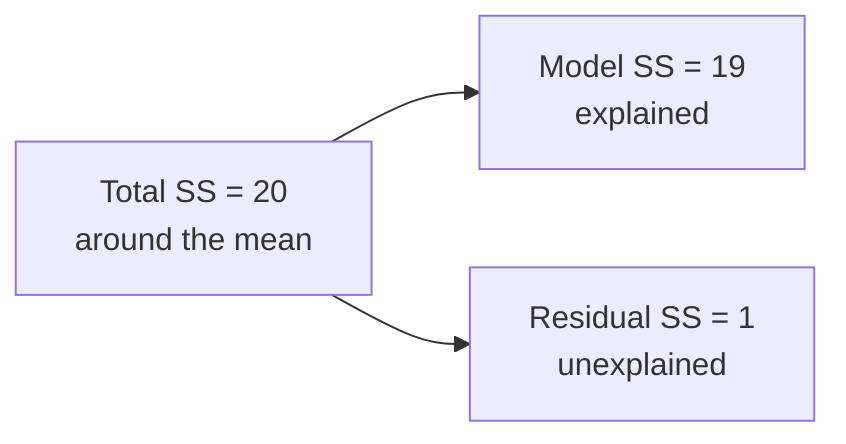

# Sum of Squares

**In one line:** a sum of squares adds up squared distances from some reference, usually the mean or a fitted line, to measure total variation.

> [!info] Before this, it helps to know
> [[Variance]] (the averaged version) · [[Summation Notation]] (the Σ symbol)

## The everyday picture
Scoring darts by how far each lands from the bullseye. To punish wild throws extra, you square each distance before adding. The total is your "badness" score: a sum of squares.

*Where the picture stops working:* in darts the bullseye is fixed. In statistics you often choose the reference point to make the score as small as possible.

## Words you'll need
- **Deviation:** a value minus a reference.
- **Total SS:** squared deviations of the data from their mean.
- **Residual SS:** squared deviations of the data from the model's fitted values.
- **Model SS:** total SS minus residual SS, the part the model explains.

## A tiny example
y = 2, 4, 6, 8 with mean 5.
- Deviations: −3, −1, 1, 3. Squares: 9, 1, 1, 9.
- Total SS = **20**.
- A model predicts 2.5, 3.5, 6.5, 7.5. Residuals: −0.5, 0.5, −0.5, 0.5. Residual SS = 4 × 0.25 = **1**.
- The model explains 20 − 1 = 19 of 20, so R² = **0.95**.

## Start from zero
1. **Pick a reference.** The mean, or each point's fitted value.
2. **Take each deviation and square it.** *Why:* squaring removes signs and weights big misses heavily.
3. **Add them up.** That is a sum of squares.
4. **Total SS splits in two.** Total = explained by the model + left over in residuals. This split is the heart of [[ANOVA]].
5. **Divide by degrees of freedom to get a variance.** SS is a total, so it grows with n. A mean square is the fair, per-observation version.

## See it

*What to look at:* the model's job is to move as much of the total as possible into the explained box.

## Why it is this way
Squared distance is the natural currency of variation because it adds up neatly: the variation explained and the variation left over sum exactly to the total. No other measure of distance splits so cleanly. That is why least squares, R², ANOVA tables and F-tests are all built from sums of squares.

## In R
```r
y <- c(2, 4, 6, 8); x <- 1:4
sum((y - mean(y))^2)          # 20 total SS
fit <- c(2.5, 3.5, 6.5, 7.5)  # some model's fitted values
sum((y - fit)^2)              # 1 residual SS
1 - 1 / 20                    # 0.95
anova(lm(c(2.4, 3.8, 6.3, 7.5) ~ x))   # an ANOVA table lists Sum Sq for model and residuals
```
The "Sum Sq" column of `anova()` is this split.

## In the course
Least squares chooses the line with the smallest residual SS ([[Least Squares]]). Zuur's linear regression review builds the ANOVA table from sums of squares ([[Zuur et al. 2009 Ch2]]).

## Common confusions
- **"Sum of squares is the variance."** Variance is SS divided by degrees of freedom.
- **"A small residual SS means a good model."** It always shrinks as you add predictors, useful or not.

## Explain it back
- Why square the deviations instead of just adding them?
- How does total SS split, and what is R² in those terms?

*Pass test:* you can compute total and residual SS and get R² from them.

## Connections
- **Builds on:** [[Variance]], [[Summation Notation]]
- **Leads to:** [[Least Squares]], [[R-squared]], [[ANOVA]], [[Degrees of Freedom]]
- **Part of:** [[MOC 01 - Basics from Zero|MOC - Basics from Zero]]

## Flashcards

What is a sum of squares?
??
The total of squared deviations from a reference such as the mean or the fitted values.
++++

How does the total sum of squares split?
??
Total SS = model (explained) SS + residual (unexplained) SS.
++++

How do you turn a sum of squares into a variance?
??
Divide by its degrees of freedom.
++++
