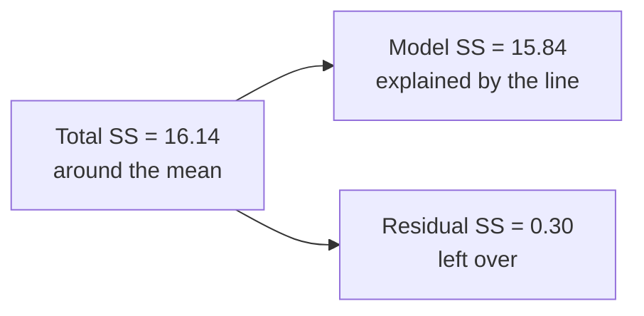

# Sum of Squares

Imagine scoring darts by how far each one lands from the bullseye, and, to punish wild throws extra, squaring each distance before adding them. The total is a badness score: a **sum of squares**. In statistics you add up squared *[[Deviation|deviations]]* (each value minus a reference point) to measure [[Total Sum of Squares|total variation]]. Squaring does two jobs: it removes minus signs, so deviations cannot cancel out, and it weights big misses heavily. The reference can be the mean, giving the *total sum of squares*, or a model's [[Fitted Value|fitted values]], giving the *[[Residual Sum of Squares|residual sum of squares]]*, the variation the model leaves unexplained.

Take four observations y = 2.4, 3.8, 6.3 and 7.5, measured at x = 1, 2, 3 and 4. Their mean is 5, the deviations are −2.6, −1.2, 1.3 and 2.5, and the total sum of squares is 6.76 + 1.44 + 1.69 + 6.25 = 16.14. The best [[Equation of a Line|straight line]] through them is y = 1.78 + 0.55x, with fitted values 2.33, 4.11, 5.89 and 7.67. The leftovers (residuals) are small, and their squares add to only 0.30, the residual sum of squares. The rest, 16.14 − 0.30 = 15.84, is the *model sum of squares*: the variation the line explains. So the model explains 15.84 / 16.14 = 0.98 of the total, which is [[R-squared]]. This clean split, total = explained + unexplained, is exactly what an [[ANOVA]] table lists in its "Sum Sq" column. One caution: the split adds up exactly for the least-squares line, which is the line that makes the residual sum of squares as small as possible ([[Least Squares]]).

Squared distance is the natural currency of variation precisely because it splits so neatly; no other measure of distance divides into "explained" and "left over" so cleanly, which is why least squares, R², ANOVA tables and F-tests are all built from it ([[Zuur et al. 2009 Ch2]]). Two confusions are common. A sum of squares is not a [[Variance]]: it is a total, so it grows with every observation you add. Dividing it by its [[Degrees of Freedom]] gives the fair, per-observation version, a variance (also called a mean square). And a small residual sum of squares does not prove a good model, because it always shrinks as you add [[Predictor Variable|predictors]], useful or not. The [[Summation Notation]] for the total is Σ(yᵢ − ȳ)².


*What to look at:* the model's job is to move as much of the total as possible into the explained box.

```r
x <- 1:4; y <- c(2.4, 3.8, 6.3, 7.5)
sum((y - mean(y))^2)          # 16.14 total SS
m <- lm(y ~ x)
fitted(m)                     # 2.33 4.11 5.89 7.67
sum(resid(m)^2)               # 0.30 residual SS
1 - sum(resid(m)^2) / sum((y - mean(y))^2)   # 0.98 = R-squared
anova(m)                      # Sum Sq column: 15.84 for x, 0.30 for residuals
```
The "Sum Sq" column of `anova()` is this split.

## Connections
- **Builds on:** [[Variance]], [[Summation Notation]], [[Deviation]], [[Equation of a Line]]
- **Leads to:** [[Least Squares]], [[R-squared]], [[ANOVA]], [[Degrees of Freedom]], [[Total Sum of Squares]], [[Fitted Value]], [[Residual Sum of Squares]], [[Predictor Variable]]
- **Part of:** [[MOC 01 - Basics from Zero|MOC - Basics from Zero]]

## Flashcards

What is a sum of squares?
??
The total of squared deviations from a reference such as the mean or the fitted values.
++++

How does the total sum of squares split?
??
Total SS = model (explained) SS + residual (unexplained) SS.
++++

How do you turn a sum of squares into a variance?
??
Divide by its degrees of freedom.
++++
