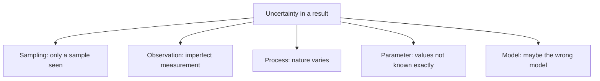

# Uncertainty

"70% chance of rain" is more honest and more useful than "it will rain": it tells you what is likely and how sure the forecaster is, so you can decide about the umbrella. **Uncertainty** in statistics is how much you do not know about a quantity, expressed as the range of values that remain plausible. A single best value is a *point estimate* ([[Estimate]]); a range of plausible values around it is an *interval*. Every estimate comes from limited, noisy data, and a different sample would give a different estimate ([[Sampling Variation]]), so a number reported without its uncertainty is incomplete.

Two surveys both estimate deer density at 12 per km². Survey A reports 12 with a [[Standard Error]] of 1, so the plausible range is roughly 10 to 14. Survey B reports 12 with a standard error of 5, a plausible range of roughly 2 to 22. Same point estimate, very different knowledge. A harvest that is safe at 10 deer per km² could be disastrous at 2, so the decision depends on how wrong you might be, not only on your best guess. Uncertainty has several sources: *sampling* (you only saw a sample), *observation* (imperfect measurement), *process* (nature itself varies), *parameter* (values not known exactly) and *model* (perhaps the wrong model altogether). It also carries forward: a prediction built on uncertain parameters must be at least as uncertain as they are.

Statistics is the craft of saying honestly how much you know, and Hobbs and Hooten frame their whole approach as gaining insight in the face of uncertainty ([[Hobbs and Hooten 2015 Ch1]]). Every unit of the course adds a tool for it: standard errors, a [[Confidence Interval]], a [[Credible Interval]], and model weights for [[Model Selection Uncertainty]]. Good models keep the sources apart; hierarchical models, for instance, separate process variation from observation error ([[Hierarchical Model]]). Two confusions to clear up: uncertainty does not mean the analysis is bad, it means the analysis is honest; and uncertainty is not the same as variability. Variability is real difference among things, such as deer differing in mass, and it does not go away. Uncertainty is your lack of knowledge, and more data shrink it.


*What to look at:* five different reasons a number could be off.

```r
set.seed(8)
a <- rnorm(100, 12, 10); b <- rnorm(4, 12, 10)   # many plots vs few plots, same truth (12)
t.test(a)$conf.int      # about 8.9 to 13.2: narrow, and it contains 12
t.test(b)$conf.int      # about -17 to 16: very wide
```
Both samples come from the same truth. With 4 plots the interval is about eight times wider, and even the centre has wandered far from 12.

## Connections
- **Builds on:** [[Estimate]], [[Standard Error]]
- **Leads to:** [[Confidence Interval]], [[Credible Interval]], [[Model Selection Uncertainty]]
- **Part of:** [[MOC 01 - Basics from Zero|MOC - Basics from Zero]]

## Flashcards

What is uncertainty in statistics?
??
The range of values that remain plausible for a quantity, given limited and noisy data.
++++

How does uncertainty differ from variability?
??
Variability is real difference among individuals. Uncertainty is lack of knowledge and shrinks with more data.
++++

Name four sources of uncertainty.
??
Sampling, observation error, process variation, and parameter or model uncertainty.
++++
