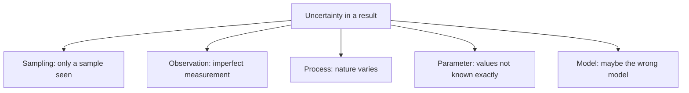

# Uncertainty

**In one line:** uncertainty is how much you don't know about a quantity, expressed as the range of values that remain plausible.

> [!info] Before this, it helps to know
> [[Estimate]] (a best guess from data) · [[Standard Error]] (the wobble of an estimate)

## The everyday picture
A weather forecast. "70% chance of rain" is more honest and more useful than "it will rain". It tells you what is likely and how sure the forecaster is, so you can decide about the umbrella.

*Where the picture stops working:* forecasts get checked every day. Most ecological estimates are never checked against a known truth.

## Words you'll need
- **Point estimate:** a single best value.
- **Interval:** a range of plausible values around it.
- **Sampling uncertainty:** doubt because you saw only a sample.
- **Model uncertainty:** doubt about which model is right.

## A tiny example
Two surveys estimate deer density at 12 per km².
- Survey A: 12 ± 1 (SE). Plausible range roughly 10 to 14.
- Survey B: 12 ± 5. Plausible range roughly 2 to 22.
- Same point estimate, very different knowledge. A harvest decision that is safe at 10 could be disastrous at 2.

## Start from zero
1. **Every estimate comes from limited, noisy data.**
2. **A different sample would give a different estimate.** ([[Sampling Variation]])
3. **So report a range, not just a number.** *Why:* decisions depend on how wrong you might be, not only on your best guess.
4. **Uncertainty has several sources.** Sampling, measurement error, natural variability, parameter doubt and model choice.
5. **Good models keep the sources separate.** Hierarchical models split process variation from observation error ([[Hierarchical Model]]).
6. **Uncertainty carries forward.** A prediction built on uncertain parameters must be at least as uncertain.

## See it

*What to look at:* five different reasons a number could be off.

## Why it is this way
Statistics is the craft of saying honestly how much you know. A number without uncertainty invites overconfidence, and in management overconfidence costs populations. Hobbs and Hooten frame the whole Bayesian approach as a way to "gain insight in the face of uncertainty".

## In R
```r
set.seed(8)
a <- rnorm(100, 12, 10); b <- rnorm(4, 12, 10)   # many plots vs few plots
t.test(a)$conf.int      # narrow interval
t.test(b)$conf.int      # wide interval around a similar centre
```
Both samples come from the same truth. The interval width shows how much each one knows.

## In the course
Hobbs and Hooten open with uncertainty as the reason for statistical models ([[Hobbs and Hooten 2015 Ch1]]). Every unit adds a tool for it: standard errors, confidence and credible intervals, model weights.

## Common confusions
- **"Uncertainty means the analysis is bad."** It means the analysis is honest.
- **"Uncertainty and variability are the same."** Variability is real difference among things. Uncertainty is your lack of knowledge, and more data shrink it.

## Explain it back
- Why is "12 ± 5" a different message from "12 ± 1"?
- Name three sources of uncertainty in a population estimate.

*Pass test:* you can explain why an estimate without an interval is incomplete.

## Connections
- **Builds on:** [[Estimate]], [[Standard Error]]
- **Leads to:** [[Confidence Interval]], [[Credible Interval]], [[Model Selection Uncertainty]]
- **Part of:** [[MOC 01 - Basics from Zero|MOC - Basics from Zero]]

## Flashcards

What is uncertainty in statistics?
??
The range of values that remain plausible for a quantity, given limited and noisy data.
++++

How does uncertainty differ from variability?
??
Variability is real difference among individuals. Uncertainty is lack of knowledge and shrinks with more data.
++++

Name four sources of uncertainty.
??
Sampling, observation error, process variation, and parameter or model uncertainty.
++++
