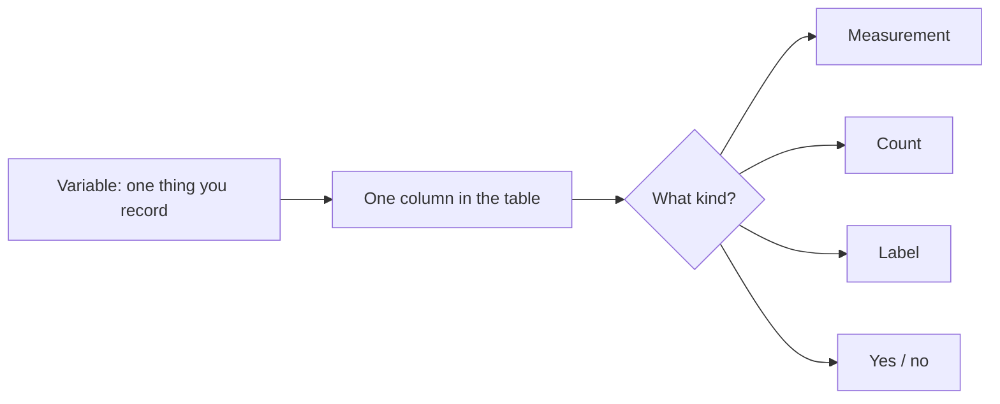

# Variable

A school register has headings across the top: age, height, favourite subject. Each heading is a **variable**: one kind of thing you record that can come out differently from case to case. Height is called a variable for the simplest reason: it varies. If every pupil were exactly 150 cm tall, height would be a *constant* and there would be nothing to study. What a variable came out as in one case is its *value*: the variable is the heading (wind), a value is one entry under it (4). Each variable is recorded on each [[Observation]], and in a data table each variable gets its own column, so that every calculation about it reads straight down one column ([[Tidy Data]]).

At three survey visits you write down habitat (grassland, grassland, shrubland), wind on a 0 to 5 scale (2, 4, 1) and bird richness (6, 5, 11). That is three variables. Habitat varies in words and the other two in numbers, and both count: labels are variables too. Variables come in kinds: measurements ([[Continuous Data]]), counts ([[Discrete Data]]), labels ([[Categorical Variable]]) and yes/no ([[Binary Variable]]). The kind matters because it decides which models are allowed, and getting it wrong, for example a number column read into R as text, quietly breaks the analysis. `str()` in R shows the kind R thinks each column is.

Why make "variable" its own idea? Because science explains differences, and a variable is the smallest unit of a difference you can record. Only things that differ can explain differences: if wind were always 2, it could not explain why richness changes from visit to visit. In a model, each variable takes a role. The one you want to explain is the *response*, and the ones you use to explain it are the *predictors* ([[Statistical Model]]). Your question decides those roles, not the data. Choosing which variables to record in the first place is also a modeling decision driven by your question, and the data exploration protocol opens by asking what each variable is ([[Data Exploration Protocol]]).


*What to look at:* every variable becomes a column, and its kind is the first thing to decide about it.

```r
birds <- data.frame(habitat  = c("grassland", "grassland", "shrubland"),
                    wind     = c(2, 4, 1),
                    richness = c(6, 5, 11))
names(birds)   # the variables: one per column
str(birds)     # the kind of each variable (chr = text, num = number)
```

## Connections
- **Builds on:** everyday record-keeping
- **Leads to:** [[Observation]], [[Continuous Data]], [[Discrete Data]], [[Categorical Variable]], [[Random Variable]]
- **Part of:** [[MOC 01 - Basics from Zero|MOC - Basics from Zero]], molecular note [[Variable and Observation]]
- **Go deeper:** [[Tidy Data]]

## Flashcards

What is a variable?
??
One kind of thing you record that can take different values from case to case; one column of a data table.
++++

Why can't something that never changes explain a pattern?
??
Explaining a difference needs something that differs too; a constant is the same everywhere.
++++
