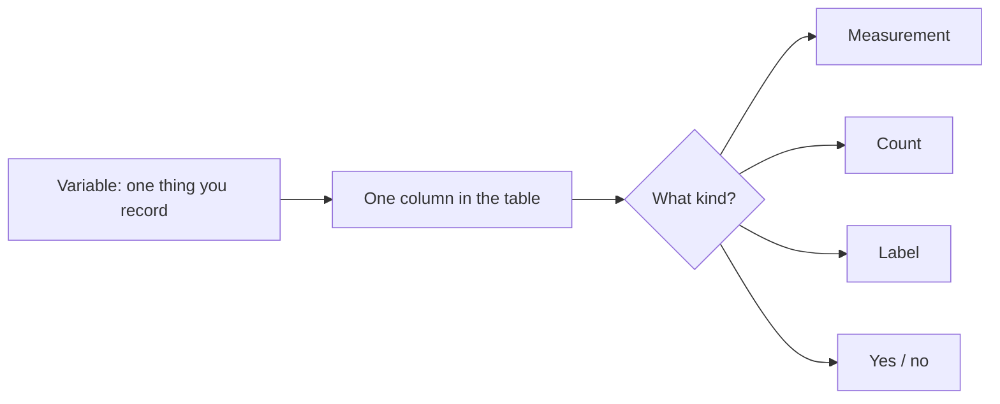

# Variable

**In one line:** a variable is one kind of thing you record that can come out differently from case to case, such as species richness, wind speed or habitat type.

> [!info] Before this, it helps to know
> Nothing. This is a starting point. Its partner idea is [[Observation]] (the case you record it on).

## The everyday picture
A school register has headings across the top: age, height, favourite subject. Each heading is a variable. Height is called a variable for the simplest reason: it *varies*. It isn't the same for every pupil. If every pupil were exactly 150 cm, height would be a constant and there'd be nothing to study.

*Where the picture stops working:* a teacher's headings are fixed in advance. In a study, choosing which variables to record is a modeling decision driven by your question.

## Words you'll need
- **Value:** what a variable came out as in one case (richness = 6).
- **Constant:** something that's the same in every case, so not a variable.
- **Column:** in a data table, each variable gets its own column ([[Tidy Data]]).
- **Response and predictor:** the roles a variable can play in a model. The response is the one you want to explain; predictors are the ones you use to explain it ([[Statistical Model]]).

## A tiny example
At three survey visits you write down habitat, wind and bird richness:
- habitat: grassland, grassland, shrubland
- wind (0 to 5 scale): 2, 4, 1
- richness: 6, 5, 11

That's **3 variables**. Each took different values across the visits, so each one varies. Habitat varies in words, the other two in numbers; both count as variables.

## Start from zero
1. **You record several things on each visit.** Habitat, wind, richness.
2. **Each thing can come out differently on a different visit.** *Why that matters:* only things that differ can explain differences. If wind were always 2, it couldn't explain why richness changes.
3. **So each thing you record is a variable, and gets one column in your table.** *Why one column each:* every calculation about that thing (its average, its plot) then reads straight down one column.
4. **Variables come in kinds:** measurements ([[Continuous Data]]), counts ([[Discrete Data]]), labels ([[Categorical Variable]]) and yes/no ([[Binary Variable]]). *Why it matters:* the kind decides which models are allowed.
5. **In a model a variable takes a role.** The one you want to explain is the response; the ones that explain it are predictors. Your question decides the roles, not the data.

## See it

*What to look at:* every variable becomes a column, and its kind is the first thing to decide about it.

## Why it is this way
Science explains differences. A variable is the smallest unit of "a difference you can record". Naming it as its own idea forces two questions before any analysis: *what* exactly did I record, and *what kind* of values can it take? Getting either wrong (for example, a number column read in as text) quietly breaks the model.

## In R
```r
birds <- data.frame(habitat  = c("grassland", "grassland", "shrubland"),
                    wind     = c(2, 4, 1),
                    richness = c(6, 5, 11))
names(birds)   # the variables: one per column
str(birds)     # the kind of each variable (chr = text, num = number)
```

## In the course
Every lab starts from a table of variables, and the data exploration protocol opens by asking what each variable is ([[Data Exploration Protocol]]).

## Common confusions
- **"Labels aren't variables because they aren't numbers."** They are. They vary from case to case, just in words.
- **"A variable is the same as a value."** The variable is the heading (wind); a value is one entry under it (4).

## Explain it back
- Why is height in a school register called a variable?
- Name the variables in the tiny example and say which vary in words.
- Why couldn't a variable that never changes explain anything?

*Pass test:* you can list the variables in any spreadsheet and say what kind each one is.

## Connections
- **Builds on:** everyday record-keeping
- **Leads to:** [[Observation]], [[Continuous Data]], [[Discrete Data]], [[Categorical Variable]], [[Random Variable]]
- **Part of:** [[MOC 01 - Basics from Zero|MOC - Basics from Zero]], molecular note [[Variable and Observation]]
- **Go deeper:** [[Tidy Data]]

## Flashcards

What is a variable?
??
One kind of thing you record that can take different values from case to case; one column of a data table.
++++

Why can't something that never changes explain a pattern?
??
Explaining a difference needs something that differs too; a constant is the same everywhere.
++++
