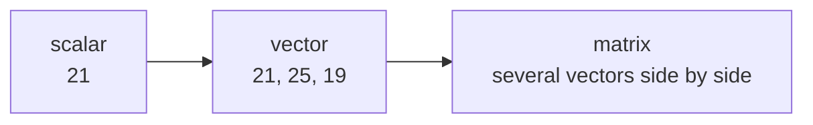

# Vector

A shopping list with quantities reads 2, 1, 6. On its own each number means nothing, but in order (apples, loaves, eggs) the list is one complete description. A **vector** is an ordered list of numbers treated as one object. Each entry is an *element*, the number of elements is its *length*, and in print vectors are written in bold, **y**, to tell them from single numbers (called *scalars*). A column of a dataset is a vector: the responses for all n observations form **y**, and you name its i-th element with a subscript, yᵢ ([[Subscripts and Indexing]]). In physics a vector is an arrow; here it is just an ordered list.

Arithmetic on vectors works element by element. If **y** = (21, 25, 19) are the masses of three voles, then y₂ = 25, **y** + (1, 1, 1) = (22, 26, 20) and 2 × **y** = (42, 50, 38). One more operation matters enormously, the *dot product*: multiply two vectors element by element and add the results. The dot product of **b** = (10, 0.5) and **x** = (1, 6) is 10 × 1 + 0.5 × 6 = 13. Look at what that is: an intercept of 10 plus a slope of 0.5 times an x of 6. A regression prediction is each [[Regression Coefficient|coefficient]] times its [[Predictor Variable|predictor]], all summed, which is exactly a dot product.

Models describe many observations with one rule, and treating a whole column as one object lets one short equation cover every row. Put several vectors side by side and you get a [[Matrix]], which is how a whole regression is written in one line ([[Matrix Notation for Models]]). It is also how R thinks: R's basic data structure is the vector ([[Vectors in R]]), and code that works on whole vectors instead of looping is shorter and faster ([[Vectorization]]). One R trap: `*` multiplies element by element, so a dot product needs `sum(b * x)` or the matrix operator `b %*% x`. Hobbs and Hooten write parameters as a vector θ and data as **y** ([[Hobbs and Hooten 2015 Ch3]]). Each element of a data vector is one [[Variable]]'s value for one observation.


*What to look at:* a vector is one column, a matrix is a table of them.

```r
y <- c(21, 25, 19)
y[2]; length(y)          # 25 and 3
y + 1; 2 * y             # element-wise
b <- c(10, 0.5); x <- c(1, 6)
sum(b * x)               # 13: the dot product
b %*% x                  # 13 again, as matrix multiplication
```
`c()` builds a vector. `%*%` is R's matrix multiplication operator.

## Connections
- **Builds on:** [[Variable]], [[Subscripts and Indexing]]
- **Leads to:** [[Matrix]], [[Matrix Notation for Models]], [[Vectors in R]], [[Regression Coefficient]], [[Predictor Variable]]
- **Part of:** [[MOC 01 - Basics from Zero|MOC - Basics from Zero]]

## Flashcards

What is a vector?
??
An ordered list of numbers treated as a single object.
++++

What is a dot product?
??
Multiply two vectors element by element and add the results.
++++

Why is a regression prediction a dot product?
??
It is each coefficient times its predictor value, all summed.
++++
