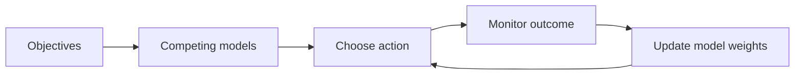

# Adaptive Resource Management

You season a soup by adding salt on a guess, tasting, and adjusting. You do not wait for a perfect recipe before cooking, and you do not keep adding the same amount without tasting. **Adaptive resource management** (ARM) applies that loop to wildlife and land management: each management action, such as setting a harvest quota or burning a field, is treated as an experiment, and *monitoring* the result (measuring the system after acting) improves the [[Model]] used for the next decision. The key ingredient is a set of *competing models*, rival ideas of how the system responds, each making a [[Forecast]] that monitoring can check. Soup responds in seconds; ecosystems respond over years, and you cannot easily undo too much salt, which is why the learning has to be deliberate.

An example. Two models of a duck population: harvest adds to natural deaths (model A), or harvest is partly compensated by lower natural mortality (model B). Start by trusting each equally, 50% each. Under a quota of 1,000, A predicts next year's count at 9,000 and B at 9,600. Monitoring then finds 9,500. B predicted better, so trust shifts toward it; weighting each model by how well it predicted (with a counting error of about 300), the weights become about 21% for A and 79% for B, and next year's quota leans on B. This updating of [[Akaike Weight|model weights]] is [[Bayes' Theorem]] at work, and the weights themselves are [[Model Probabilities]].

The steps are: state the objective (say, a sustainable harvest), write competing models, choose the action that is best given current trust in each model, monitor what happens, update the trust, and repeat. Decisions improve while management continues. Managers cannot wait for certainty, and trial and error without models wastes years; ARM is the disciplined middle path. It is not just trial and error, because it needs explicit models and predictions first, and monitoring alone is not adaptive, because monitoring that never changes a decision or a model is just counting. Powell and Gale frame the whole need for [[Parameter Estimation|parameter estimation]] inside adaptive management ([[Powell and Gale 2015 Ch1]]). The basic, non-learning version of the loop is the [[Management Cycle]].


*What to look at:* learning is built into the loop of doing.

```r
weight <- c(A = 0.5, B = 0.5)                 # current trust
pred   <- c(A = 9000, B = 9600); obs <- 9500
lik    <- dnorm(obs, pred, sd = 300)          # how well each predicted the count
weight <- weight * lik / sum(weight * lik)
round(weight, 2)                              # A 0.21, B 0.79
```
This updating of model weights is Bayes' theorem at work ([[Bayes' Theorem]]).

## Connections
- **Builds on:** [[Model]], [[Forecast]], [[Parameter Estimation]]
- **Leads to:** [[Management Cycle]], [[Model Probabilities]], [[Bayes' Theorem]], [[Akaike Weight]]
- **See also:** [[Hypothesis]]
- **Part of:** [[MOC 02 - Modeling Foundations|MOC - Modeling Foundations]]

## Flashcards

What is adaptive resource management?
??
Managing while learning: act on current models, monitor the outcome, and update trust in each model.
++++

What is updated after monitoring in adaptive management?
??
The weight given to each competing model of how the system responds.
++++

Why isn't monitoring alone adaptive management?
??
Without models making predictions, outcomes can't change beliefs or decisions in a structured way.
++++
