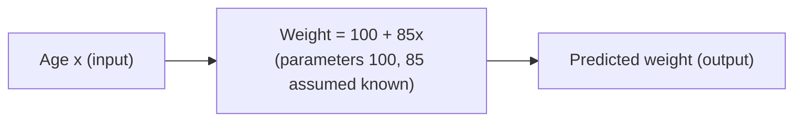

# Analytical Model

**In one line:** an analytical (or numerical) model is a mathematical equation that gives a number as its answer, such as Weight = 100 + 85 × age for a young elephant.

> [!info] Before this, it helps to know
> [[Functions in Maths]] (an equation turns inputs into outputs) · [[Conceptual Model]] (the idea the equation makes precise)

## The everyday picture
A recipe that scales. "For each guest, use 150 g of pasta, plus 100 g extra for the pot." Tell it 4 guests and it tells you 700 g. It's a rule written so exactly that anyone can apply it and get the same answer. You didn't measure anything today; the 150 and 100 came from experience.

An analytical model is that kind of rule for nature. "A young elephant weighs 100 kg at birth and gains about 85 kg a year." Give it an age, get a weight.

*Where the picture stops working:* a recipe doesn't care if guests are hungrier than usual. Real elephants vary around the rule, and an analytical model on its own doesn't describe that variation.

## Words you'll need
- **Analytical (numerical) model:** a model written as an equation that returns a number.
- **Equation:** a statement that two things are equal, used here as a rule for calculating.
- **Parameter:** a fixed number in the equation (100 and 85 here). In an analytical model it's taken as known.
- **Deterministic:** the same input always gives the same output; no randomness ([[Deterministic and Stochastic Components]]).
- **Equilibrium:** a state where the model stops changing.
- **BIDE:** Births, Immigration, Deaths, Emigration, the four ways a population changes.

## A tiny example
**Elephant weight.** Weight (kg) = 100 + 85 × age in years ([[Powell and Gale 2015 Ch1]], p. 6).
- Age 0: 100 kg. Age 1: 185 kg. Age 3: 100 + 255 = **355 kg**.

**A population's change this year (BIDE).** 40 births, 25 deaths, 5 animals arrive, 8 leave.
- Change = 40 − 25 + 5 − 8 = **+12 animals**.

Both answers came straight from arithmetic. No data were analysed, no uncertainty was reported.

## Start from zero
1. **A conceptual model says *that* things are linked.** An analytical model says *exactly how*.
2. **Write the link as an equation.** Weight = 100 + 85x, where x is age in years.
3. **Plug in an input and get a number.** At age 3, 355 kg.
4. **The numbers in the equation are parameters, taken as given.** They come from earlier studies or best guesses. *Why that matters:* the model doesn't estimate them from data and says nothing about how sure we are of them. Adding that is what a [[Statistical Model]] does.
5. **Analytical models can be studied with pure maths.** Theoretical ecologists find equilibria and stability conditions without any data at all ([[Theoretical vs Empirical Modeling]]).
6. **When the equations get too tangled to solve by hand, run them on a computer step by step.** That's a [[Simulation Model]].

## See it

*What to look at:* there's no data and no uncertainty in this picture. Put in the same x and you always get the same answer, so the model is *deterministic* ([[Deterministic and Stochastic Components]]).

## Why it is this way
Writing an idea as an exact equation makes it precise and testable: "elephants gain 85 kg a year" can be checked; "elephants get bigger" can't really be wrong. It also lets you ask "what if?" cheaply: what if growth slows to 60 kg a year? Hobbs and Hooten say that's the great strength of the theoretical tradition: its parameters "symbolize quantities in nature" ([[Hobbs and Hooten 2015 Ch2]], p. 18). The price is that the equation is only as good as the parameter values you fed it.

## In R
```r
weight <- function(age) 100 + 85 * age
weight(0:5)        # 100 185 270 355 440 525

bide <- function(B, D, I, E) B - D + I - E
bide(40, 25, 5, 8) # +12 animals this year
```

## In the course
This is one of Powell and Gale's model types, alongside conceptual, graphical and statistical ([[Powell and Gale 2015 Ch1]], pp. 5 to 6). The BIDE model is the "fundamental model" their primer keeps returning to.

## Common confusions
- **Analytical vs statistical.** An analytical model takes parameters as given. A statistical model estimates them from data, with uncertainty.
- **"Deterministic means certain."** It means the model gives the same output every time. Whether that output matches nature is a separate question.
- **"Analytical means complicated maths."** Here it just means "an equation that gives a number". 100 + 85x counts.

## Explain it back
- Use a scaling recipe to explain an analytical model.
- What weight does the elephant model give at age 2, and where did the 100 and 85 come from?
- What does a statistical model add that an analytical model lacks?

*Pass test:* you can write the BIDE equation from memory and say what each letter means.

## Connections
- **Builds on:** [[Functions in Maths]], [[Conceptual Model]]
- **Leads to:** [[Statistical Model]], [[Simulation Model]], [[Sensitivity Analysis]], [[Deterministic Functions in Ecology]]
- **Part of:** [[MOC 02 - Modeling Foundations|MOC - Modeling Foundations]]
- **Go deeper:** [[Hobbs and Hooten 2015 Ch2]]

## Flashcards

What is the difference between an analytical model and a statistical model?
??
An analytical model is an equation with parameters taken as given; a statistical model estimates the parameters from data, with uncertainty.
++++

Write the BIDE model and say what it means.
??
ΔN = B − D + I − E: change in population size equals births minus deaths plus immigrants minus emigrants.
++++
