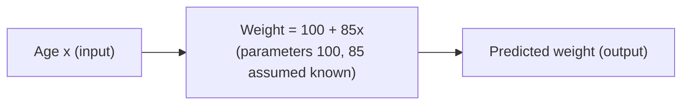

# Analytical Model

A recipe that scales says "for each guest, use 150 g of pasta, plus 100 g extra for the pot". Tell it 4 guests and it tells you 700 g. It is a rule written so exactly that anyone who applies it gets the same answer, and its numbers came from experience, not from anything measured today. An **analytical model** (Powell and Gale also call it a numerical model) is that kind of rule for nature: a mathematical equation that gives a number as its answer ([[Functions in Maths]]). It takes the idea in a [[Conceptual Model]], that two things are linked, and states exactly how. The fixed numbers in its equation are parameters, and in an analytical model they are taken as known, not estimated.

Powell and Gale's example: a young elephant's weight in kilograms = 100 + 85 × its age in years ([[Powell and Gale 2015 Ch1]]). At age 0 it weighs 100 kg, at age 1, 185 kg, and at age 3, 100 + 255 = 355 kg. Another example is the [[Population Dynamics|BIDE model]] of population change, change = births − deaths + immigrants − emigrants: with 40 births, 25 deaths, 5 arrivals and 8 departures, the population changes by 40 − 25 + 5 − 8 = +12 animals. Both answers come straight from arithmetic; no data were analysed and no uncertainty was reported. The model is *deterministic*: the same input always gives the same output ([[Deterministic and Stochastic Components]]).

Writing an idea as an exact equation makes it precise and testable: "elephants gain 85 kg a year" can be checked, while "elephants get bigger" can hardly be wrong. It also lets you ask cheap what-if questions, such as what happens if growth slows to 60 kg a year. Theoretical ecologists study such models with pure maths, finding equilibria (states where the model stops changing) and stability conditions without any data at all, which Hobbs and Hooten describe as the strength of the theoretical tradition: its parameters stand for quantities in nature ([[Hobbs and Hooten 2015 Ch2]], [[Theoretical vs Empirical Modeling]]). The price is that the equation is only as good as the parameter values fed into it, and real elephants vary around the rule. Estimating the parameters from data, with uncertainty, and describing the scatter is what a [[Statistical Model]] adds; and when the equations become too tangled to solve by hand, running them step by step on a computer gives a [[Simulation Model]]. "Analytical" does not mean complicated maths here, and deterministic does not mean certain to match nature.


*What to look at:* there's no data and no uncertainty in this picture. Put in the same x and you always get the same answer, so the model is *deterministic* ([[Deterministic and Stochastic Components]]).

```r
weight <- function(age) 100 + 85 * age
weight(0:5)        # 100 185 270 355 440 525

bide <- function(B, D, I, E) B - D + I - E
bide(40, 25, 5, 8) # +12 animals this year
```

## Connections
- **Builds on:** [[Functions in Maths]], [[Conceptual Model]], [[Population Dynamics]]
- **Leads to:** [[Statistical Model]], [[Simulation Model]], [[Sensitivity Analysis]], [[Deterministic Functions in Ecology]]
- **Part of:** [[MOC 02 - Modeling Foundations|MOC - Modeling Foundations]]
- **Go deeper:** [[Hobbs and Hooten 2015 Ch2]]

## Flashcards

What is the difference between an analytical model and a statistical model?
??
An analytical model is an equation with parameters taken as given; a statistical model estimates the parameters from data, with uncertainty.
++++

Write the BIDE model and say what it means.
??
ΔN = B − D + I − E: change in population size equals births minus deaths plus immigrants minus emigrants.
++++
