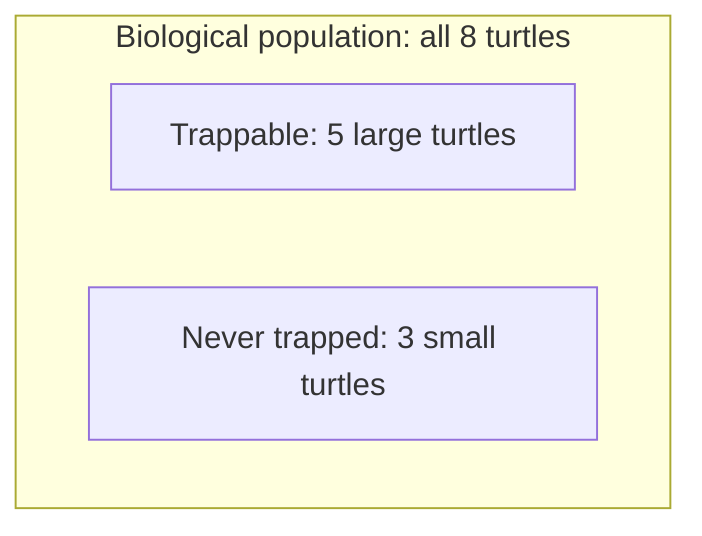

# Biological Population

**In one line:** a biological population is a group of organisms of one species living in a certain place at a certain time, such as all the turtles in one pond this summer.

> [!info] Before this, it helps to know
> [[Population]] (the statistical meaning, which is different)

## The everyday picture
Everyone who lives in one town this year. Babies, grandparents, people who never leave the house: all of them count, whether or not anyone ever surveys them. A biological population is defined by *who is there*, not by who you can reach.

*Where the picture stops working:* towns have borders and censuses. Animal populations have fuzzy edges and move around.

## Words you'll need
- **Species:** a kind of organism.
- **Biological population:** all individuals of a species in a place and time ([[Powell and Gale 2015 Ch2]], p. 13).
- **Statistical population:** the units your method could actually sample, which may be smaller ([[Statistical Population]]).
- **Abundance:** how many individuals there are.

## A tiny example
A pond holds 8 turtles with shells of 4, 5, 6, 12, 14, 15, 18 and 20 cm.
- **Biological population:** all 8. Mean shell length 94 / 8 = **11.75 cm**.
- That's the number a biologist means by "the turtles in this pond", including the three small ones that never enter a trap.

## Start from zero
1. **Biologists define a population by species, place and time.**
2. **Every individual counts**, however hard it is to find. *Why:* the definition is about nature, not about methods.
3. **It's usually the thing ecologists ultimately care about:** how many, how fast they're growing, how many survive.
4. **But methods rarely reach every individual.** The part you *can* reach is the [[Statistical Population]], and your conclusions stop there.

## See it

*What to look at:* the biological population includes the small turtles whether or not you can catch them.

## Why it is this way
Ecology's questions are about real organisms, so the biological population is the natural target. Naming it separately from the statistical population keeps you honest about the gap between what you want to know and what your method can tell you.

## In R
```r
turtles <- c(4, 5, 6, 12, 14, 15, 18, 20)   # shell lengths, cm
length(turtles)                             # 8 individuals in the biological population
mean(turtles)                               # 11.75 cm
```

## In the course
Powell and Gale open their chapter on context with this definition ([[Powell and Gale 2015 Ch2]], p. 13).

## Common confusions
- **"Biological population = statistical population."** Only if your method can reach every individual.
- **"Population always means animals."** That's the biological meaning; the statistical one can be plots or days.

## Explain it back
- Use a town's residents to explain a biological population.
- In the pond, what is the biological population and its mean shell length?
- Why might your sample never include some members of it?

*Pass test:* you can define the biological population for any study by species, place and time.

## Connections
- **Builds on:** [[Population]]
- **Leads to:** [[Statistical Population]], [[Sampling Unit]], [[Bias]]
- **Part of:** [[MOC 02 - Modeling Foundations|MOC - Modeling Foundations]], molecular note [[Biological vs Statistical Population]]
- **Go deeper:** [[Powell and Gale 2015 Ch2]]

## Flashcards

What is a biological population?
??
The organisms of one species living in a certain place at a certain time, whether or not any method can reach them.
++++

Why name the biological population separately from the statistical one?
??
To keep clear the gap between what you want to know (all organisms) and what your method can actually sample.
++++
