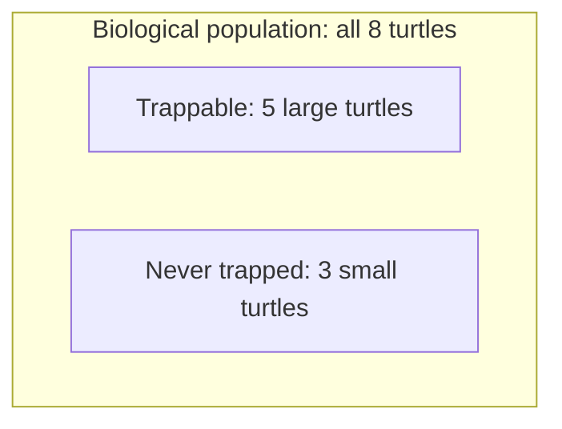

# Biological Population

Everyone who lives in one town this year counts as a resident: babies, grandparents, people who never leave the house, whether or not anyone ever surveys them. A **biological population** is defined the same way, by who is there: a group of organisms of one species living in a certain place at a certain time, such as all the turtles in one pond this summer ([[Powell and Gale 2015 Ch2]]). Every individual counts, however hard it is to find, because the definition is about nature, not about methods. Towns have borders and censuses, but animal populations have fuzzy edges and move around. The number of individuals in it is its *abundance*.

A pond holds 8 turtles with shells of 4, 5, 6, 12, 14, 15, 18 and 20 cm. The biological population is all 8 of them, with a mean shell length of 94 / 8 = 11.75 cm. That is what a biologist means by "the turtles in this pond", including the three small ones that never enter a trap. If your traps only ever catch the five large turtles, your data describe those five, whose mean is 15.8 cm, a quite different answer.

This is why the biological population is kept separate from the statistical one. It is usually what ecologists ultimately care about: how many there are, how fast they are growing, how many survive. But methods rarely reach every individual, and the part you can reach is the [[Statistical Population]]; your conclusions stop at its edge unless you can argue, with biology or design, that the two are alike ([[Line of Inference]]). Do not confuse the two meanings of "population": in statistics the word means whatever set your conclusion is about, which can be plots or days ([[Population]]), while in biology it always means organisms of one species. The two coincide only when your method can reach every individual ([[Biological vs Statistical Population]]).


*What to look at:* the biological population includes the small turtles whether or not you can catch them.

```r
turtles <- c(4, 5, 6, 12, 14, 15, 18, 20)   # shell lengths, cm
length(turtles)                             # 8 individuals in the biological population
mean(turtles)                               # 11.75 cm
```

## Connections
- **Builds on:** [[Population]]
- **Leads to:** [[Statistical Population]], [[Sampling Unit]], [[Bias]]
- **Part of:** [[MOC 02 - Modeling Foundations|MOC - Modeling Foundations]], molecular note [[Biological vs Statistical Population]]
- **Go deeper:** [[Powell and Gale 2015 Ch2]]

## Flashcards

What is a biological population?
??
The organisms of one species living in a certain place at a certain time, whether or not any method can reach them.
++++

Why name the biological population separately from the statistical one?
??
To keep clear the gap between what you want to know (all organisms) and what your method can actually sample.
++++
