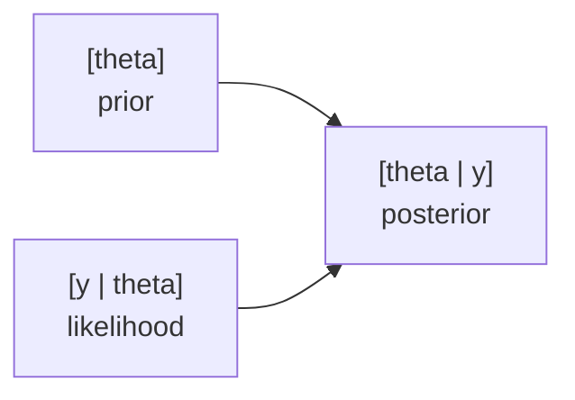

# Bracket Notation

A recipe book might write "180/20" instead of "bake in an oven at 180 degrees for 20 minutes"; once you know the code, long instructions shrink to a glance. **Bracket notation** does this for probability statements. Square brackets mean "the probability distribution of", so [a] is the distribution of a ([[Probability Distribution]]). A vertical bar means "given", so [a | b] is the distribution of a given b ([[Conditional Probability]]), and a comma means "and", so [a, b] is the [[Joint Probability|joint distribution]] of a and b together. Read the quantity left of the bar as random and the quantity right of it as known for now. This is Hobbs and Hooten's house style, less common elsewhere, and it is introduced in [[Hobbs and Hooten 2015 Ch3]].

Read a Bayesian model aloud with it. [y | θ] is "the distribution of the data given the parameters", the likelihood. [θ] is "the distribution of the parameters", the prior. And [θ | y] ∝ [y | θ][θ] reads "the posterior is [[Proportional To|proportional to]] the likelihood times the prior", which is Bayes' theorem in one line ([[Bayes' Theorem]]). With numbers: if a candidate value θ = 0.3 has [[Prior Distribution|prior probability]] [θ = 0.3] = 0.5 and the data have probability [y | θ = 0.3] = 0.2 under it, their product, 0.1, is that value's unnormalized posterior weight; dividing every candidate's weight by the total turns the weights into posterior probabilities.

Why a new notation? Because hierarchical models stack several layers (data, process, parameters), and written in full with P(Y = y | Θ = θ) for every piece they become a wall of symbols. Brackets show at a glance which quantity depends on which, and that is exactly the skill needed to write model code later ([[Hierarchical Model]], [[Chain Rule of Probability|Factoring a Joint Distribution]], [[Hobbs and Hooten 2015 Ch6]]). Two confusions to avoid: [a | b] does not mean a divided by b, the bar means "given"; and in this book brackets do not mean a matrix or an R index, they mean a distribution. A quick test: [z | y, θ] reads "the distribution of z given y and θ".


*What to look at:* three bracketed pieces are the whole of Bayes' theorem.

```r
theta <- c(0.3, 0.5, 0.7)            # three candidate values
prior <- c(0.5, 0.3, 0.2)            # [theta]
lik   <- dbinom(7, 10, theta)        # [y | theta] for 7 successes in 10
post  <- lik * prior / sum(lik * prior)   # [theta | y]
round(rbind(theta, prior, lik, post), 3)
```
Each row of the table is one bracket expression.

## Connections
- **Builds on:** [[Conditional Probability]], [[Probability Distribution]], [[Proportional To]]
- **Leads to:** [[Bayes' Theorem]], [[Hierarchical Model]], [[Chain Rule of Probability|Factoring a Joint Distribution]], [[Joint Probability]], [[Prior Distribution]]
- **See also:** [[Greek Letters and Notation]]
- **Part of:** [[MOC 02 - Modeling Foundations|MOC - Modeling Foundations]]

## Flashcards

What does [y | θ] mean?
??
The probability distribution of y given θ.
++++

How is Bayes' theorem written in bracket notation?
??
[θ | y] ∝ [y | θ][θ].
++++

In [a | b], which quantity is treated as known?
??
b, the one to the right of the bar.
++++
