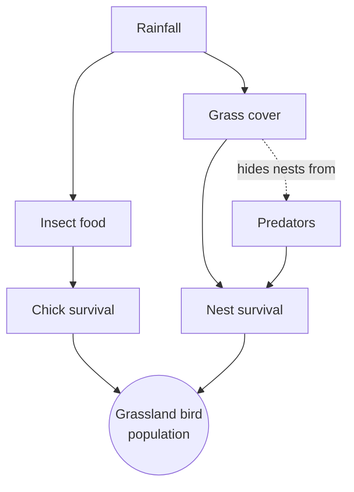

# Conceptual Model

Picture a detective's pinboard: the victim in the middle, photos of suspects around it, and string between them for "seen together" or "owed money". Nothing is proven yet. The board is the detective's current theory, laid out so each string can be checked. A **conceptual model** is an ecologist's pinboard: your idea of what affects what, put into words or a sketch before any equation. Powell and Gale's recipe is to put the study species in the centre of a page, write the factors that affect its survival and reproduction around it (habitat, predators, rainfall, food), and draw an arrow for each link you believe exists ([[Powell and Gale 2015 Ch1]]). They call the purely mental version conceptual and the version on paper or in 3D a *physical* model. It is the [[Real World and Model World|Model World]] made visible.

Each arrow is a [[Hypothesis]], a claim waiting to be tested, and each one later becomes a modeling decision. Take a grassland bird. Your sketch says rainfall → grass cover → nest survival, and predators → nest survival. The arrows pointing *into* nest survival come from grass cover and predators, so the model is "nest survival depends on grass cover and predators". Rainfall acts only *through* grass cover (an *indirect effect*: A affects C only by way of B), so it is left out; putting rainfall and grass cover in together would make them compete to explain the same thing ([[Collinearity]]). One drawing gave one modeling decision, made before any results were seen. In R the sketch becomes the formula `nest_survived ~ grass_cover + predator_index`, where every variable on the right is a *predictor*, a variable used to explain the response.

Drawing the sketch first forces you to say what you believe before the data can talk you into something. With dozens of variables some pattern will always turn up by chance, and a sketch made in advance protects you from fishing through the data and calling the catch a discovery ([[Data Dredging]], [[Why build the candidate model set before seeing the data]]). It is also the right starting point when you know little, because it tells you which data to collect first ([[Why model at all]]). Do not mistake informal for unimportant: the sketch decides what you measure and which models you compare, so it shapes every result. More arrows is not better either; include the links that matter for your question ([[Parsimony]]). Hobbs and Hooten later formalise the same picture as Bayesian network diagrams ([[Directed Acyclic Graph|Bayesian Network Diagram]]), and the next step from a sketch is an exact equation, an [[Analytical Model]].


*What to look at:* every arrow is a claim you could test. Rainfall affects the population only *through* food and cover in this sketch, and that is itself a hypothesis.

```r
# A conceptual model becomes a model formula: each arrow into the response is a predictor
# nest_survived ~ grass_cover + predator_index
# (Rainfall is left out because, in our sketch, it acts only through grass cover)
f <- nest_survived ~ grass_cover + predator_index
all.vars(f)     # the variables your conceptual model says matter
```

## Connections
- **Builds on:** [[Real World and Model World]]
- **Leads to:** [[Hypothesis]], [[Candidate Model Set]], [[Directed Acyclic Graph|Bayesian Network Diagram]], [[Statistical Model]]
- **Part of:** [[MOC 02 - Modeling Foundations|MOC - Modeling Foundations]]
- **Go deeper:** [[Powell and Gale 2015 Ch1]]

## Flashcards

What is a conceptual model, and how do you draw one?
??
Your Model World in words or a sketch: put the species in the centre, the factors affecting it around it, and arrows for the links you believe exist.
++++

Why draw a conceptual model before fitting statistics?
??
Each arrow is a hypothesis stated in advance, which guides which variables and models to use and guards against data dredging.
++++
