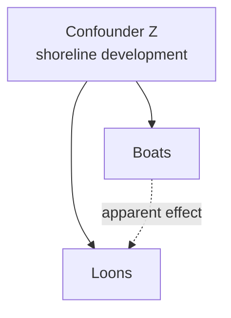

# Confounding Variable

Ice cream sales and drownings rise and fall together, but ice cream does not drown anyone. Hot weather sends people both to the ice cream van and into the water. Heat is the **confounding variable**: a variable that influences both the [[Explanatory Variable]] and the [[Response Variable]], creating an association between them that is not cause and effect. The defining shape is a common cause, Z, with arrows into both X and Y, so X and Y move together through Z even if X does nothing to Y. Heat is easy to spot; in field data the confounder is often something nobody recorded.

An example. Lakes with more boats have fewer loons, and boats might disturb loons. Or perhaps big lakes near towns attract boats and also have more shoreline houses, which destroy nesting habitat. If "development" drives both boats and loon loss, banning boats might change nothing. A simulation shows how convincing a false effect can look: let development raise boat numbers and lower loon numbers while boats have no effect at all. A regression of loons on boats alone finds a slope of about −0.6, a clear "boat effect" that is entirely spurious, and adding development to the model brings the boat slope back to about zero. The association is real; the causal reading is wrong ([[Correlation]], [[Correlation vs Causation]]).

There are three defences. Randomize X, which breaks Z's link to X ([[Randomization]]); measure Z and include it in the model, which is what "holding it constant" means ([[Holding Other Variables Constant]]); or compare units within levels of Z. But do not adjust for everything in sight: a variable that lies on the causal path from X to Y is part of the effect you want, and adjusting for it hides that effect, while adjusting for consequences of the response can create bias. Confounding is also not the same as [[Collinearity]]: collinearity simply means predictors are correlated with each other, while confounding is a causal claim about a common cause, although confounded predictors are often collinear and hard to separate. This gap between association and cause is why regression coefficients from field data need careful wording ([[Guthery and Bingham 2007]]) and why [[Observational Study]] results stay tentative.


*What to look at:* Z is a common cause, the defining shape of confounding.

```r
set.seed(8)
dev <- rnorm(300)                                 # development
boats <- 5 + 2 * dev + rnorm(300)
loons <- 10 - 1.5 * dev + rnorm(300)              # boats have NO effect here
coef(lm(loons ~ boats))["boats"]                  # about -0.6: spurious
coef(lm(loons ~ boats + dev))["boats"]            # about 0 once development is in the model
```
Including the confounder removes the false boat effect.

## Connections
- **Builds on:** [[Explanatory Variable]], [[Correlation]]
- **Leads to:** [[Observational Study]], [[Randomization]], [[Holding Other Variables Constant]], [[Correlation vs Causation]]
- **Part of:** [[MOC 02 - Modeling Foundations|MOC - Modeling Foundations]]

## Flashcards

What is a confounding variable?
??
A variable that affects both the explanatory variable and the response, producing a non-causal association between them.
++++

Name three ways to handle confounding.
??
Randomize the treatment, include the confounder in the model, or compare within its levels.
++++

Why not adjust for every available variable?
??
Variables that lie on the causal path or are consequences of the response can introduce bias when adjusted for.
++++
