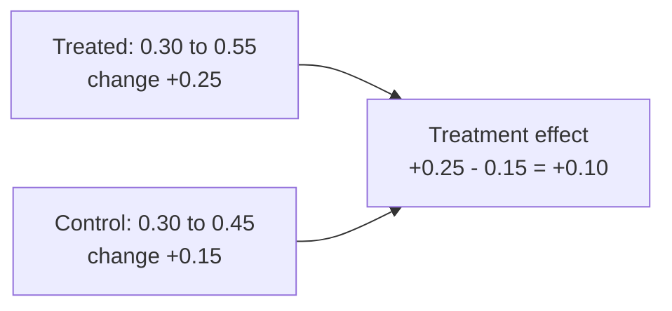

# Control Group

A before-and-after photo for a diet cannot show that the diet worked: without someone who did not diet over the same months, you cannot tell whether the change came from the diet or from summer. The non-dieter is the control. A **control group** is the set of units that do not receive the [[Treatment]] but are otherwise handled exactly the same way, giving the baseline for comparison. It answers the question every result needs: compared with what? A single non-dieter is not enough, though; controls need [[Replication]] too, and their status should be assigned at random ([[Randomization]]).

Here is the arithmetic. In one wet spring, sprayed thistle plots see seedling survival rise from 0.30 to 0.55, which looks like +0.25 from spraying. But unsprayed controls over the same spring rise from 0.30 to 0.45, so the season alone gave +0.15. The spray's own effect is the difference of the differences: (0.55 − 0.30) − (0.45 − 0.30) = +0.10. Things change over time anyway (weather, season, observers learning), treated units experience both the treatment and those changes, and control units experience only the changes, so subtracting removes what the two have in common. Comparing changes rather than levels is the idea behind before-after-control-impact designs.

Controls must be handled identically: visited, marked and disturbed in the same way. When applying a treatment has side effects, such as the wetting and trampling that come with spraying, the controls get a *sham treatment*, a procedure that mimics the handling without the active ingredient, such as spraying plain water. Two confusions: a before measurement on the treated unit is not a control, because it controls for the unit but not for what changed over time; and controls should not be left completely alone, they should get everything except the active ingredient. In a fitted model the control usually becomes the [[Reference Level]] against which treatment coefficients are measured, and a control group is a key defence against a [[Confounding Variable]] in any [[Experimental Study]].


*What to look at:* the control's change is subtracted from the treated group's change.

```r
d <- data.frame(group = rep(c("control", "sprayed"), each = 2), time = rep(c("before", "after"), 2),
                surv = c(0.30, 0.45, 0.30, 0.55))
with(d, tapply(surv, list(group, time), mean))
(0.55 - 0.30) - (0.45 - 0.30)        # 0.10: difference of the differences
```
Comparing changes, not levels, is the before-after-control-impact idea.

## Connections
- **Builds on:** [[Treatment]], [[Experimental Study]]
- **Leads to:** [[Reference Level]], [[Confounding Variable]], [[Randomization]]
- **See also:** [[Treatment|Treatment and Control]]
- **Part of:** [[MOC 02 - Modeling Foundations|MOC - Modeling Foundations]]

## Flashcards

What is a control group?
??
Units that don't receive the treatment but are otherwise handled identically, giving the baseline.
++++

Why isn't a before-after comparison on treated units enough?
??
Other things change over time, and only a control shows what would have happened anyway.
++++

What is a sham treatment?
??
A control procedure that mimics the handling of the treatment without its active ingredient.
++++
