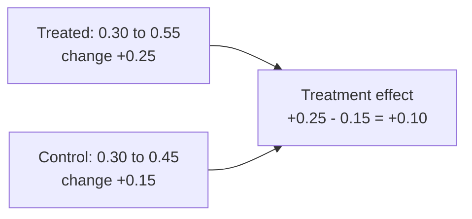

# Control Group

**In one line:** a control group is the set of units that do not receive the treatment but are otherwise handled the same way, giving the baseline for comparison.

> [!info] Before this, it helps to know
> [[Treatment]] (the applied condition) · [[Experimental Study]] (assigning conditions)

## The everyday picture
A before-and-after photo for a diet. Without a second person who didn't diet over the same months, you can't tell whether the change came from the diet or from summer. The non-dieter is the control.

*Where the picture stops working:* a single non-dieter is not enough. Controls need replication too.

## A tiny example
Insecticide and seedling survival, one wet spring.
- Sprayed plots: survival rises from 0.30 to 0.55.
- Looks like +0.25 from spraying.
- Unsprayed controls over the same spring: 0.30 to 0.45.
- The season gave +0.15. The spray's own effect is 0.55 − 0.45 = **+0.10**.

## Start from zero
1. **Things change over time anyway.** Weather, season, observer learning.
2. **Treated units experience both the treatment and those changes.**
3. **Control units experience only those changes.**
4. **Subtract.** *Why:* what is common to both cancels, leaving the treatment's contribution.
5. **Handle controls identically.** Visit, mark and disturb them the same way. A sham treatment (water spray) covers side effects.
6. **Assign control status at random.**

## See it

*What to look at:* the control's change is subtracted from the treated group's change.

## Why it is this way
A response needs a "compared with what?". The control answers it by showing what would have happened anyway. In models it is usually the reference level against which treatment coefficients are measured ([[Reference Level]]).

## In R
```r
d <- data.frame(group = rep(c("control", "sprayed"), each = 2), time = rep(c("before", "after"), 2),
                surv = c(0.30, 0.45, 0.30, 0.55))
with(d, tapply(surv, list(group, time), mean))
(0.55 - 0.30) - (0.45 - 0.30)        # 0.10: difference of the differences
```
Comparing changes, not levels, is the before-after-control-impact idea.

## In the course
The unsprayed subplots in Homework 4 are the controls ([[Course Website]]).

## Common confusions
- **"A before measurement is a control."** It controls for the unit, not for what changed over time.
- **"Controls should be left completely alone."** They should get everything except the active ingredient.

## Explain it back
- Why is before-and-after on treated plots alone not enough?
- What is a sham treatment for?

*Pass test:* you can compute a treatment effect net of the control's change.

## Connections
- **Builds on:** [[Treatment]], [[Experimental Study]]
- **Leads to:** [[Reference Level]], [[Confounding Variable]], [[Randomization]]
- **Part of:** [[MOC 02 - Modeling Foundations|MOC - Modeling Foundations]], molecular note [[Treatment|Treatment and Control]]

## Flashcards

What is a control group?
??
Units that don't receive the treatment but are otherwise handled identically, giving the baseline.
++++

Why isn't a before-after comparison on treated units enough?
??
Other things change over time, and only a control shows what would have happened anyway.
++++

What is a sham treatment?
??
A control procedure that mimics the handling of the treatment without its active ingredient.
++++
