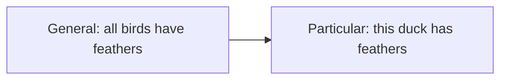

# Deduction

"All trains on this line stop at Central. I am on a train on this line. So my train stops at Central." If the first two sentences are true, the third cannot be false. **Deduction** is reasoning from a general rule to a particular case, and a deduction is *valid* when its conclusion follows necessarily from its starting statements, called *premises*. A numeric version: a population has 200 animals and 40% of them are female, so it has 0.4 × 200 = 80 females. Nothing uncertain happens along the way, which is why deduction runs from the general to the specific with no [[Error Bars|error bars]] ([[Powell and Gale 2015 Ch2]]).

That certainty has a price. A deduction adds nothing beyond what its premises already contain: the 80 females were hidden inside "200 animals, 40% female". So deduction alone can never teach you something new about nature, and its conclusion is only as true as its premises. If one train skips Central on Sundays, the reasoning breaks, and only observation would tell you. Calling deduction "better because it is certain" misses this; the certainty is conditional, and checking the premises needs observation, which is the job of [[Induction]]. Deduction is also not just maths: any reasoning from a rule to a case counts.

Science uses deduction for one vital step: turning a hypothesis into a *prediction*, a statement of what you should observe if the hypothesis is true. From "predators limit nest success" you deduce "nests in denser cover should survive better". Without that step a hypothesis would make no checkable claims at all. Induction then judges the prediction against data, and together the two make up the testing loop of the [[Scientific Method|scientific method]] ([[Hypothesis]]).


*What to look at:* the arrow runs from the general to the specific, and nothing is uncertain along it.

```r
# Deduction is plain arithmetic from premises
N <- 200; prop_female <- 0.4
N * prop_female    # 80: guaranteed if the premises are true
```

## Connections
- **Builds on:** [[Hypothesis]], [[Scientific Method]]
- **Leads to:** [[Induction]], [[Inferential Modeling]], [[Error Bars]]
- **Part of:** [[MOC 02 - Modeling Foundations|MOC - Modeling Foundations]], molecular note [[Induction vs Deduction]]
- **Go deeper:** [[Powell and Gale 2015 Ch2]]

## Flashcards

What is deduction?
??
Reasoning from general premises to a particular conclusion that must be true if the premises are.
++++

What role does deduction play in science?
??
It turns a hypothesis into a prediction that data can test.
++++
