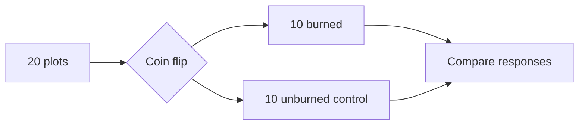

# Experimental Study

To test fertilizer in your garden, you pick ten matching pots, flip a coin for each to decide which get fertilizer, and treat them identically otherwise. If the fertilized pots grow more, the fertilizer is the only systematic difference between the groups. An **experimental study** (or manipulative experiment) is one where the researcher assigns the conditions, ideally at random, and then measures what follows. Contrast it with an [[Observational Study]], where you watch conditions that nature or people set. Pots on a bench are easy to control; a whole watershed cannot be put on a bench, which is the main limitation of experiments in ecology.

Twenty plots, and a coin flip assigns 10 to be burned. Before burning, both groups average about 6 species, because the coin made them alike. After burning, the burned plots average 9 and the unburned 6, and the 3-species difference can be credited to burning, because nothing else differed systematically. The reason is chance assignment ([[Randomization]]): soil, dryness and history cannot line up with the treatment except by luck, and the statistics account for luck. In a simulation where dryness affects [[Species Richness|richness]] and burning adds a true effect of 0.4 on the log scale, random assignment recovers the 0.4 even though dryness is left out of the model entirely, because the coin left dryness and burning uncorrelated.

So an experiment needs three things: assignment by chance, an untreated comparison ([[Control Group]]), and [[Replication]], because one burned plot and one unburned plot cannot separate the treatment from the plot. With those in place, a difference supports a causal claim. Researcher assignment is the only general way to rule out [[Confounding|confounding]] without having to name the confounders. Two cautions: any [[Treatment|manipulation]] without randomization and replication is an anecdote, not a good experiment; and experiments do not always beat observation, since they win on cause but lose on scale and realism. Homework 4's thistle study is an experiment with an insecticide treatment in a nested layout, and experiments with group factors are classically analysed with [[ANOVA]].


*What to look at:* the coin, not the landscape, decides who gets treated.

```r
set.seed(5)
dry <- rnorm(200)
burned <- rbinom(200, 1, 0.5)                       # assigned by coin, unrelated to dryness
birds <- rpois(200, exp(1.8 + 0.3 * dry + 0.4 * burned))
coef(glm(birds ~ burned, family = poisson))["burned"]   # close to the true 0.4 without knowing dryness
cor(dry, burned)                                    # near 0: randomization balanced it
```
The effect is recovered even though dryness was left out of the model.

## Connections
- **Builds on:** [[Observational Study]], [[Randomization]], [[Treatment]]
- **Leads to:** [[Control Group]], [[Replication]], [[ANOVA]], [[Species Richness]], [[Confounding]]
- **Part of:** [[MOC 02 - Modeling Foundations|MOC - Modeling Foundations]], molecular note [[Observational vs Experimental Study]]

## Flashcards

What defines an experimental study?
??
The researcher assigns the treatments, ideally at random.
++++

Why does random assignment support causal claims?
??
It makes treatment independent of all other variables, so they can't systematically explain the difference.
++++

What is the main weakness of experiments in ecology?
??
Limited scale and realism compared with whole landscapes.
++++
