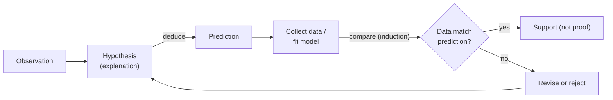

# Hypothesis

Your phone battery has started dying by lunchtime, and you guess: "it's that new game running in the background." That guess is a **hypothesis**: a proposed explanation for something you noticed. It is useful because it makes a *prediction*, a statement of what you should see if it is true: "close the game and the battery will last until evening." You cannot watch the game drain the battery, so you test what should happen *if* the guess were right. If the battery still dies at lunch, the guess was wrong and you try another. A good hypothesis is stated clearly enough that data could prove it wrong, because an explanation that fits any result, such as "birds are scarce because of nature", can never teach you anything.

In ecology the loop runs the same way. You notice some grassland nests fail and some survive. Hypothesis: predators find nests more easily where cover is thin. From it you *deduce* a prediction ([[Deduction]]): nests in denser cover should survive better. You fit a model in which nest survival depends on cover, and the cover slope comes out at 0.8 on the log-odds scale, clearly above zero. The prediction holds, so the hypothesis is *supported*, not proven: cover might also bring more insects, which could produce the same pattern. Judging data against a prediction is [[Induction]], and Powell and Gale note the cycle of observation, hypothesis, prediction and test is nearly the same as adaptive management ([[Powell and Gale 2015 Ch2]]).

In modeling, each hypothesis becomes a model: "richness depends on grass cover" becomes `richness ~ cover`, and several competing hypotheses become a set of competing models compared with a tool such as AIC ([[Candidate Model Set]]). When you state a hypothesis matters. An *a priori* one ("from before") is stated before looking at the data; one found by searching the data is *post hoc* ("after this") and needs new data to test, because the same data cannot both suggest an idea and confirm it ([[Exploration, Inference and Prediction]]). Anderson and Burnham argue that the hard thinking belongs in the hypotheses before analysis ([[Anderson and Burnham 2002]]). Two confusions: the hypothesis is the explanation and the prediction is its observable consequence, and a scientific hypothesis is not the statistical *null hypothesis* (such as slope = 0), which is only a testing device ([[Null Hypothesis Significance Testing]]). Each arrow in a [[Conceptual Model]] is a hypothesis.


*What to look at:* the loop is the scientific method, and Powell and Gale note it's nearly the same cycle as adaptive management ([[Powell and Gale 2015 Ch2]], pp. 12 to 13).

```r
# Two hypotheses about fuel efficiency, written as two competing models
h1 <- lm(mpg ~ wt, data = mtcars)        # H1: weight matters
h2 <- lm(mpg ~ wt + hp, data = mtcars)   # H2: weight and power both matter
AIC(h1, h2)                              # which hypothesis do the data favour?
```

## Connections
- **Builds on:** [[Induction vs Deduction]], [[Conceptual Model]]
- **Leads to:** [[Candidate Model Set]], [[Null Hypothesis Significance Testing]], [[Multi-model Inference]], [[Exploration, Inference and Prediction]]
- **See also:** [[Final Project]]
- **Part of:** [[MOC 02 - Modeling Foundations|MOC - Modeling Foundations]]
- **Go deeper:** [[Anderson and Burnham 2002]]

## Flashcards

What is the difference between a hypothesis and a prediction?
??
A hypothesis is a proposed explanation; a prediction is what you deduce you should observe if it is true.
++++

What is an a priori hypothesis and why does it matter?
??
One stated before looking at the data; only a priori hypotheses can be fairly tested on that data.
++++

How does a hypothesis enter a statistical analysis?
??
It is written as a model (e.g., richness ~ cover); competing hypotheses become competing models.
++++
