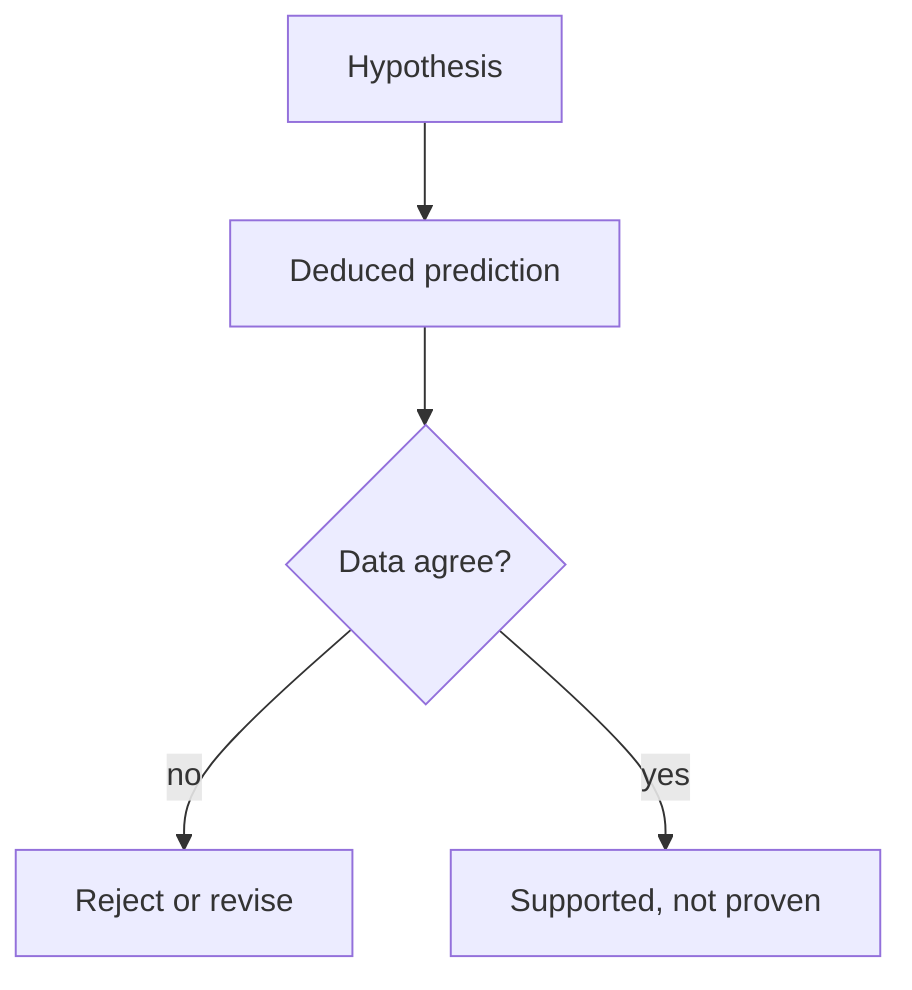

# Hypothetico-deductive Method

A detective suspects the butler: "if the butler did it, his shoes will match the prints". Check the shoes. A mismatch clears him for certain. A match only keeps him on the list, because other people own such shoes. The **hypothetico-deductive method** works the same way: start from a hypothesis (the *hypothetico* part), reason to a consequence that must hold if it is true (the *deductive* part, [[Deduction]]), and then try to show that the consequence fails. The key is an *asymmetry*: a failed prediction refutes, because a true hypothesis cannot have a false consequence, while a successful prediction only supports, because a false hypothesis can still make a prediction that happens to come true. It is the test step of the wider [[Scientific Method]].

An example. Hypothesis: fire increases grassland bird richness. Deduced consequence: burned plots will hold more species than unburned ones. A study of 30 plots of each finds means of 9.1 species on burned plots and 6.4 on unburned ones, and a test says a gap that large would be unlikely by chance. The prediction survived a real chance of failing, so the hypothesis is supported, but not proven: grazing, which also differs between the plot types, could produce the same pattern. That is why a good design tries to make the prediction clearly able to fail, and why the stronger version tests several rival hypotheses at once, so that the data can tell them apart ([[Multiple Working Hypotheses]], [[Strong Inference]]).

Why insist on risky predictions? Because confirming evidence is cheap: almost any idea has some. Surviving a real chance of failure is the only kind of support worth much. Null hypothesis significance testing is a narrow statistical version of this method ([[Null Hypothesis Significance Testing]]), but a null of "no effect at all" is rarely a hypothesis anyone actually holds, and information-theoretic model selection grew partly from dissatisfaction with that narrow version. Powell and Gale describe hypothetico-deductive science before introducing model-based inference ([[Powell and Gale 2015 Ch1]]), and Anderson and Burnham argue for comparing several hypotheses directly ([[Anderson and Burnham 2002]]).


*What to look at:* the two branches are not equal. "No" is decisive, "yes" is provisional.

```r
set.seed(6)
burned <- rpois(30, 9); unburned <- rpois(30, 6.5)
c(mean(burned), mean(unburned))
t.test(burned, unburned)$p.value     # small: the prediction survived the test
```
A small p-value means the prediction was not contradicted. It does not prove fire was the cause.

## Connections
- **Builds on:** [[Deduction]], [[Scientific Method]]
- **Leads to:** [[Null Hypothesis Significance Testing]], [[Strong Inference]], [[Multiple Working Hypotheses]]
- **Part of:** [[MOC 02 - Modeling Foundations|MOC - Modeling Foundations]]

## Flashcards

What is the hypothetico-deductive method?
??
Deduce a testable consequence from a hypothesis, then try to show the consequence fails.
++++

Why does a failed prediction count for more than a successful one?
??
A true hypothesis can't have a false consequence, but a false one can still make a prediction that happens to hold.
++++

What improves on testing a single hypothesis?
??
Testing several competing hypotheses against the same data.
++++
