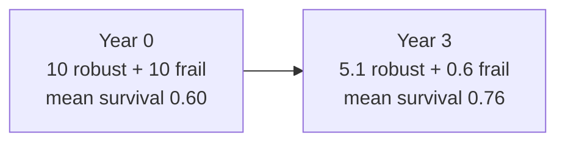

# Individual Variation

**In one line:** individual variation is the real difference between individuals in traits or fates, even under identical conditions.

> [!info] Before this, it helps to know
> [[Process Variation]] (real variation in nature) · [[Variance]] (a measure of spread)

## The everyday picture
A class sitting the same exam after the same lessons. Scores still differ, because students differ. That spread is not measurement error. It is a true feature of the class.

*Where the picture stops working:* students keep their abilities. An animal's "quality" can change with age and condition.

## A tiny example
Twenty hens, same habitat, same year.
- Average annual survival is 0.6.
- But half are robust (survival 0.8) and half are frail (0.4).
- After 3 years: robust survivors 10 × 0.8³ = 5.1, frail 10 × 0.4³ = 0.6. The surviving flock is now 89% robust, and its average survival has risen to about 0.76 without any hen changing.

## Start from zero
1. **Individuals differ** in size, age, genes, experience, luck of territory.
2. **So each has its own probability** of surviving, breeding or being detected.
3. **A model with one shared parameter averages over this.** That average can be fine, or it can mislead.
4. **Differences change the group over time.** *Why:* the frail leave first, so the survivors are not a fair sample of the starters.
5. **Models can include it** through covariates such as age, or through random effects for individuals ([[Random Effect]]).

## See it

*What to look at:* nobody changed, yet the average did, because of who was left.

## Why it is this way
Ignoring differences between individuals makes counts look more variable than the model expects ([[Overdispersion]]) and biases estimates of abundance when some animals are far easier to catch than others ([[Capture Heterogeneity Models]]). It is one of the main reasons simple binomial and Poisson models fail on real data.

## In R
```r
robust <- 10 * 0.8^(0:3); frail <- 10 * 0.4^(0:3)
round(rbind(robust, frail, share_robust = robust / (robust + frail),
            mean_survival = (robust * 0.8 + frail * 0.4) / (robust + frail)), 2)
```
The last row climbs from 0.60 to 0.76 purely through selective loss of frail birds.

## In the course
Powell and Gale list individual variation among the sources of variation in estimates ([[Powell and Gale 2015 Ch2]]). Random effects for individuals appear in the mixed model labs ([[Course Website]]).

## Common confusions
- **"Variation among individuals is noise."** It is real biology and often the thing of interest.
- **"Averages are safe if the sample is big."** A large sample still hides a changing mix of individuals.

## Explain it back
- Why did average survival rise in the hen example?
- How can a model represent differences among individuals?

*Pass test:* you can explain how hidden differences among individuals distort a group average over time.

## Connections
- **Builds on:** [[Process Variation]]
- **Leads to:** [[Overdispersion]], [[Random Effect]], [[Capture Heterogeneity Models]]
- **Part of:** [[MOC 02 - Modeling Foundations|MOC - Modeling Foundations]], molecular note [[Process vs Observation Error]]

## Flashcards

What is individual variation?
??
Real differences among individuals in traits or in probabilities such as survival and detection.
++++

Why can average survival of a cohort rise over time with no individual changing?
??
Frail individuals die first, leaving a group made up more and more of robust ones.
++++

What statistical symptom does unmodelled individual variation cause in counts?
??
Overdispersion: more spread than the simple model predicts.
++++
