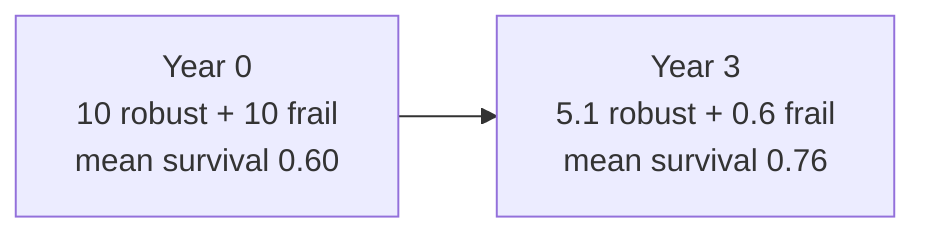

# Individual Variation

A class sits the same exam after the same lessons, and the scores still differ, because the students differ. That spread is not a measurement mistake; it is a true feature of the class. **Individual variation** is the same thing in animals and plants: real differences between individuals in their traits or their fates, even under identical conditions. Individuals differ in size, age, genes, experience and the luck of their territory, so each has its own probability of surviving, breeding or being detected. It is one important kind of [[Process Variation]], real variation in nature as opposed to error in measuring it ([[Process vs Observation Error]]).

Hidden differences can quietly change a group average. Take twenty hens in the same habitat and year with an average annual survival of 0.6, but half are robust (survival 0.8) and half are frail (0.4). After three years, 10 × 0.8³ = 5.1 robust hens and 10 × 0.4³ = 0.6 frail hens are left. The surviving flock is now 89% robust, and its average survival has risen to about 0.76, although no hen changed at all. The frail left first, so the survivors are not a fair sample of the starters. A model with one shared survival parameter averages over all this, and that average can be fine or can badly mislead about what is happening to the group.

Ignoring individual variation has two classic symptoms. Counts look more variable than a simple binomial or Poisson model expects, which is [[Overdispersion]], one of the main reasons those simple models fail on real data. And abundance estimates become biased when some animals are far easier to catch than others, the problem that [[Capture Heterogeneity Models]] address. Models can include individual differences through [[Predictor Variable|covariates]] such as age or [[Body Condition|body condition]], or through a [[Random Effect]] for each individual, which appears in the [[Mixed Effects Model|mixed model]] labs. Individual variation is not noise to be wished away; it is real biology and often the thing of interest, and a large sample does not remove it, because it can still hide a changing mix of individuals. Powell and Gale list it among the sources of variation in estimates ([[Powell and Gale 2015 Ch2]]). Variation of this kind is summarised as a [[Variance]].


*What to look at:* nobody changed, yet the average did, because of who was left.

```r
robust <- 10 * 0.8^(0:3); frail <- 10 * 0.4^(0:3)
round(rbind(robust, frail, share_robust = robust / (robust + frail),
            mean_survival = (robust * 0.8 + frail * 0.4) / (robust + frail)), 2)
```
The last row climbs from 0.60 to 0.76 purely through selective loss of frail birds.

## Connections
- **Builds on:** [[Process Variation]], [[Predictor Variable]]
- **Leads to:** [[Overdispersion]], [[Random Effect]], [[Capture Heterogeneity Models]], [[Body Condition]], [[Mixed Effects Model]]
- **Part of:** [[MOC 02 - Modeling Foundations|MOC - Modeling Foundations]], molecular note [[Process vs Observation Error]]

## Flashcards

What is individual variation?
??
Real differences among individuals in traits or in probabilities such as survival and detection.
++++

Why can average survival of a cohort rise over time with no individual changing?
??
Frail individuals die first, leaving a group made up more and more of robust ones.
++++

What statistical symptom does unmodelled individual variation cause in counts?
??
Overdispersion: more spread than the simple model predicts.
++++
