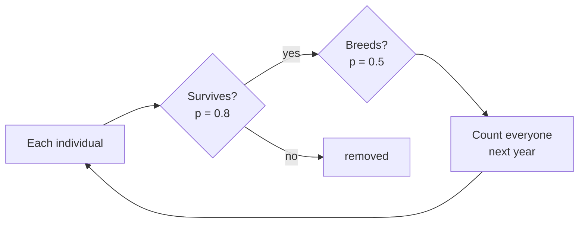

# Individual-based Model

No driver plans a traffic jam. Each follows a simple rule, such as "brake if the car ahead is close", yet put a thousand such drivers on a road and jams appear on their own. An **individual-based model** (IBM, also called an agent-based model) builds the drivers and watches for the jam. It is a [[Simulation Model]] that follows each animal or plant separately: each simulated individual, or *agent*, has its own state (age, location, energy) and its own *rules* for what it does each time step, usually involving chance ([[Randomness]]). Population patterns are not written into any rule; they are *emergent*, arising from all the individuals interacting.

A tiny version: start with 10 deer. Each year each deer survives with probability 0.8, and each survivor has a 0.5 chance of producing one fawn. One year might go: 8 survive, 4 fawns, total 12. On average the herd grows by 0.8 × 1.5 = 1.2 times per year. But run the model 1,000 times for 20 years and the endings spread widely, and a few runs go extinct purely by chance, something the average growth rate alone would never show. This is why an IBM is always run many times: a single run is one roll of the dice, and only the spread across runs tells you what to expect. That run-to-run spread is demographic chance, a form of [[Process Variation]].

Why build models this way? Equations for whole populations assume everyone is average. When individuals differ, interact only with their neighbours, or are few in number, averages mislead, and simulating individuals handles those cases directly ([[Population Dynamics]]). The price is high: many parameters, each rule an unverified guess about animal behaviour, and results that can only be learned by running the model. So more realism does not automatically mean more reliability; every added rule is another assumption. Powell and Gale list simulation among their model types ([[Powell and Gale 2015 Ch1]]), and Hobbs and Hooten contrast it with theoretical and [[Empirical Model|empirical modeling]] ([[Hobbs and Hooten 2015 Ch2]]). The same loop-over-individuals idea is how you simulate data to test a statistical method ([[Simulating Data]]).


*What to look at:* the loop runs once per individual per year.

```r
set.seed(2)
one_run <- function(n0 = 10, years = 20) {
  n <- n0
  for (t in 1:years) {
    surv <- rbinom(1, n, 0.8)          # each deer survives or not
    n <- surv + rbinom(1, surv, 0.5)   # each survivor may add a fawn
  }
  n
}
runs <- replicate(1000, one_run())
summary(runs); mean(runs == 0)          # wide spread, a few extinctions
```
Same rules, very different endings. That spread is demographic chance.

## Connections
- **Builds on:** [[Simulation Model]], [[Empirical Model]]
- **Leads to:** [[Process Variation]], [[Population Dynamics]], [[Simulating Data]]
- **Part of:** [[MOC 02 - Modeling Foundations|MOC - Modeling Foundations]]

## Flashcards

What is an individual-based model?
??
A simulation that follows each individual by simple rules and lets population patterns emerge.
++++

Why run an individual-based model many times?
??
Each run includes chance, so only the spread across runs shows what to expect.
++++

What is an emergent pattern?
??
One that arises from many individuals interacting, without being written into any rule.
++++
