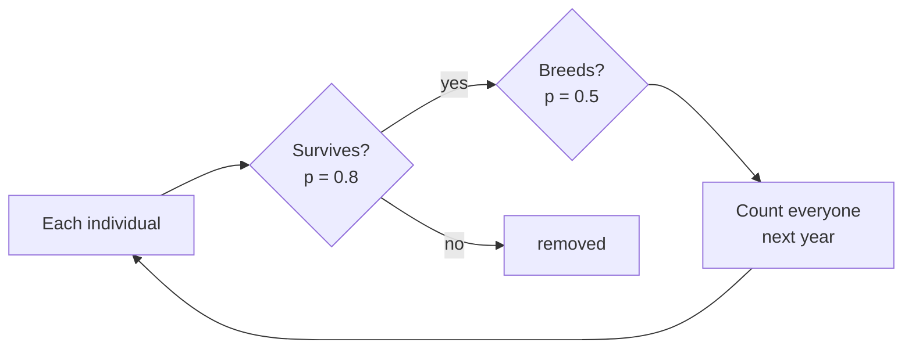

# Individual-based Model

**In one line:** an individual-based model simulates each animal or plant separately, following simple rules, and lets population patterns emerge from their combined behaviour.

> [!info] Before this, it helps to know
> [[Simulation Model]] (a model run on a computer) · [[Randomness]] (chance in outcomes)

## The everyday picture
A traffic jam. No driver plans a jam. Each follows a rule ("brake if the car ahead is close"). Put a thousand such drivers on a road and jams appear on their own. An individual-based model builds the drivers and watches for the jam.

*Where the picture stops working:* drivers' rules are fairly well known. Animals' rules are guesses, and the output is only as good as those guesses.

## Words you'll need
- **Agent:** one simulated individual with its own state (age, location, energy).
- **Rule:** what an agent does each time step.
- **Emergent:** arising from many interactions, not written into any single rule.

## A tiny example
10 deer. Each year each deer survives with probability 0.8, and each survivor has a 0.5 chance of one fawn.
- Year 1 might go: 8 survive, 4 fawns, total 12.
- Expected growth per year = 0.8 × 1.5 = **1.2**.
- Run it 1,000 times and some runs go extinct by chance, something the average alone would never show.

## Start from zero
1. **List the individuals and their states.**
2. **Give each a rule involving chance.** Survive? Breed? Move?
3. **Step through time, applying the rules to every individual.**
4. **Record the totals.** *Why:* the population pattern is not assumed, it emerges.
5. **Repeat many times.** Each run differs, so you look at the spread of outcomes.

## See it

*What to look at:* the loop runs once per individual per year.

## Why it is this way
Equations for whole populations assume everyone is average. When individuals differ, interact locally or are few, averages mislead. Simulating individuals handles those cases directly. The price is many parameters and results that can only be learned by running the model.

## In R
```r
set.seed(2)
one_run <- function(n0 = 10, years = 20) {
  n <- n0
  for (t in 1:years) {
    surv <- rbinom(1, n, 0.8)          # each deer survives or not
    n <- surv + rbinom(1, surv, 0.5)   # each survivor may add a fawn
  }
  n
}
runs <- replicate(1000, one_run())
summary(runs); mean(runs == 0)          # wide spread, a few extinctions
```
Same rules, very different endings. That spread is demographic chance.

## In the course
Powell and Gale list simulation among model types ([[Powell and Gale 2015 Ch1]]). Hobbs and Hooten contrast it with theoretical and empirical modeling ([[Hobbs and Hooten 2015 Ch2]]).

## Common confusions
- **"More realistic means more reliable."** Every added rule is another unverified assumption.
- **"One run is the answer."** A single run is one roll of the dice.

## Explain it back
- What does "emergent" mean for a traffic jam?
- Why run an individual-based model many times?

*Pass test:* you can describe the loop an individual-based model repeats.

## Connections
- **Builds on:** [[Simulation Model]]
- **Leads to:** [[Process Variation]], [[Population Dynamics]], [[Simulating Data]]
- **Part of:** [[MOC 02 - Modeling Foundations|MOC - Modeling Foundations]]

## Flashcards

What is an individual-based model?
??
A simulation that follows each individual by simple rules and lets population patterns emerge.
++++

Why run an individual-based model many times?
??
Each run includes chance, so only the spread across runs shows what to expect.
++++

What is an emergent pattern?
??
One that arises from many individuals interacting, without being written into any rule.
++++
