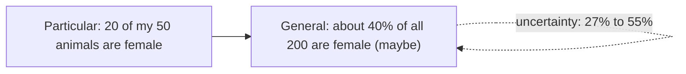

# Induction

"Every swan I have ever seen is white, so all swans are white." It feels safe, until someone shows you a black swan from Australia. **Induction** is reasoning from particular cases to a general rule, and because its conclusion goes beyond the evidence, it can be caught out by a case you have not met. That sounds like a weakness, but induction is the only way to learn something new about nature. Powell and Gale put it plainly: induction is central to statistical inference, the step from a [[Sample]] to a [[Population]], or from the past to the future ([[Powell and Gale 2015 Ch2]]).

A numeric example. You catch 50 animals from a population of 200, and 20 are female. The inductive conclusion is "about 40% of the population is female". How wrong might it be? A 95% [[Confidence Interval]] runs from about 27% to 55%, so the true number of females could be anywhere from about 54 to 110. That interval *is* the honest size of the inductive leap, and it is why every statistical conclusion comes with a measure of uncertainty: a [[Standard Error|standard error]], an interval or a posterior. [[Bayes' Theorem]] later gives a formal way to update such conclusions as evidence accumulates.

Induction is only as good as the sample. A bigger sample makes the leap more precise, but a sample that is not representative stays wrong however large it is, because no maths can recover cases the sample never reflected ([[Representative Sample]], [[Bias]]). And induction never proves anything; it supports conclusions with stated uncertainty. Its partner is [[Deduction]], which turns a hypothesis into a prediction; induction then judges the prediction against the data ([[Hypothesis]]).


*What to look at:* the arrow runs from the few to the many, and the dotted loop is the uncertainty that comes with it.

```r
prop.test(20, 50)$conf.int    # about 0.27 to 0.55: the size of the inductive leap
```

## Connections
- **Builds on:** [[Sample]], [[Population]], [[Standard Error]]
- **Leads to:** [[Deduction]], [[Confidence Interval]], [[Representative Sample]], [[Frequentist vs Bayesian Inference]]
- **Part of:** [[MOC 02 - Modeling Foundations|MOC - Modeling Foundations]], molecular note [[Induction vs Deduction]]
- **Go deeper:** [[Powell and Gale 2015 Ch2]]

## Flashcards

What is induction?
??
Reasoning from particular cases to a general conclusion (sample to population); the conclusion may be wrong.
++++

Why does every statistical result come with a measure of uncertainty?
??
Because statistical inference is induction: generalizing from a sample to a population could be wrong, and the SE, CI or posterior says by how much.
++++
