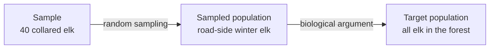

# Line of Inference

Think of a relay race where the baton is your conclusion. It must pass from the sample to the sampled population to the population you actually care about, and if it is dropped at any handover it never reaches the finish, however fast the other runners were. The **line of inference** is that chain of steps from the animals you measured to the population you want to talk about, and a conclusion is only as strong as its weakest link. *Inference* means reasoning from data to something not directly observed. The *[[Population|target population]]* is what you want to make statements about ([[Biological Population]]); the *sampled population* is what your methods could actually have reached ([[Statistical Population]], [[Study Population]]).

You want to know the survival of elk in a national forest, and you collar 40 elk caught near roads in winter. The first link, sample to sampled population, is fine if capture was random among roadside winter elk ([[Random Sampling]], [[Representative Sample]]). The second link, sampled population to target population, is weak: elk far from roads, and summer conditions, were never represented. A simulation shows the danger. If roadside elk survive at 0.85 and the rest at 0.70, the whole forest's survival is about 0.75, but a sample of 40 roadside elk reports about 0.85: a precise answer to a narrower question, and a wrong answer to the forest-wide one. The honest conclusion is "survival of roadside elk in winter was about 0.85".

The crucial point is which link statistics covers. A model's standard errors and confidence intervals describe only the first link; they say nothing about whether the sampled population resembles the one you care about. That gap can be closed only by study design or biological argument, never by more statistics ([[Study Design]]). So a narrow [[Confidence Interval|confidence interval]] does not make a conclusion safe beyond the sampled population, and a large sample of the wrong population is just precisely wrong. Keeping the whole chain in view stops a precise answer to the wrong question from being mistaken for knowledge, which is exactly why Powell and Gale separate biological and statistical populations ([[Powell and Gale 2015 Ch2]]).


*What to look at:* the first arrow is statistics. The second is judgement.

```r
set.seed(3)
forest <- data.frame(near_road = rep(c(TRUE, FALSE), c(300, 700)))
forest$surv <- rbinom(1000, 1, ifelse(forest$near_road, 0.85, 0.70))
mean(forest$surv)                                   # truth for the whole forest: about 0.75
mean(sample(forest$surv[forest$near_road], 40))     # road-side sample: about 0.85
mean(sample(forest$surv, 40))                       # random sample: near 0.75
```
The road-side sample answers a narrower question precisely and the forest-wide question wrongly.

## Connections
- **Builds on:** [[Statistical Population]], [[Biological Population]], [[Representative Sample]], [[Population]]
- **Leads to:** [[Study Population]], [[Random Sampling]], [[Study Design]], [[Confidence Interval]]
- **Part of:** [[MOC 02 - Modeling Foundations|MOC - Modeling Foundations]], molecular note [[Biological vs Statistical Population]]

## Flashcards

What is the line of inference?
??
The chain from sample to sampled population to target population that a conclusion must travel.
++++

Which link do standard errors and confidence intervals cover?
??
Only sample to sampled population.
++++

What justifies extending results from the sampled to the target population?
??
Study design or biological argument, not statistics.
++++
