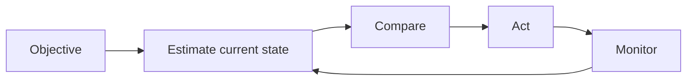

# Management Cycle

A thermostat has a target temperature, measures the room, compares the two, and switches the heater on or off; then it measures again. Without the measuring step it would just be a heater. The **management cycle** is the same loop for wildlife management: set an *objective* (a target state, such as 500 breeding pairs), estimate the current state, compare state with objective, take an *action* to move toward it, and monitor again. The comparison step is *evaluation*. A thermostat measures temperature exactly, but managers measure populations with large error, which is why [[Parameter Estimation]] sits right where the loop touches reality.

Here is why the uncertainty matters. The objective is 500 pairs, and this year's estimate is 420 pairs with a [[Standard Error|standard error]] of 30. The plausible range (about two standard errors either side) runs from roughly 360 to 480, which lies wholly below 500, so the population is probably below target, and the manager restricts the harvest. Next year's estimate is 470 with the same standard error, a range of roughly 410 to 530. That range now includes 500, so the data no longer say clearly that the objective is unmet. The quality of the estimate, not just its value, drives the decision ([[Confidence Interval]]).

Every step that says "estimate" or "monitor" needs a number with honest uncertainty, because a manager comparing 420 with 500 must know whether the gap is real or just sampling noise. That practical need is the reason the course's statistics matter outside a classroom, and it is how Powell and Gale motivate estimating [[Abundance]] and survival ([[Powell and Gale 2015 Ch1]]). Two confusions: an estimate is not the population itself, and the decision should respect its interval; and the management cycle is not the same as [[Adaptive Resource Management]], which adds competing models and deliberate learning from each action. Good monitoring is designed in advance so that its estimates are precise enough to support the decisions it feeds ([[Study Design]]).


*What to look at:* estimation sits at the point where the loop touches reality.

```r
est <- c(420, 470); se <- 30
data.frame(estimate = est, low = est - 1.96 * se, high = est + 1.96 * se, target_inside = est + 1.96 * se >= 500)
```
In year 1 the target is outside the interval. In year 2 it is inside, so the data no longer say the objective is unmet.

## Connections
- **Builds on:** [[Adaptive Resource Management]], [[Parameter Estimation]], [[Standard Error]]
- **Leads to:** [[Confidence Interval]], [[Abundance]], [[Study Design]]
- **Part of:** [[MOC 02 - Modeling Foundations|MOC - Modeling Foundations]]

## Flashcards

What are the steps of the management cycle?
??
Set objectives, estimate the current state, compare, act, monitor, and repeat.
++++

Why do managers need the uncertainty of an estimate?
??
To tell whether a gap between the estimate and the objective is real or just sampling noise.
++++

What does adaptive management add to the basic cycle?
??
Competing models and deliberate learning from each action.
++++
