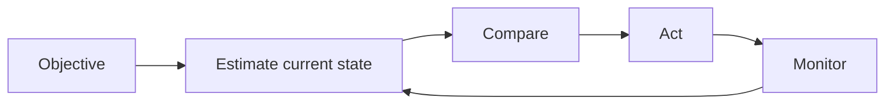

# Management Cycle

**In one line:** the management cycle is the repeating sequence of setting objectives, acting, monitoring and evaluating that wildlife management follows.

> [!info] Before this, it helps to know
> [[Adaptive Resource Management]] (the learning version of the cycle) · [[Parameter Estimation]] (how monitoring becomes numbers)

## The everyday picture
A thermostat. It has a target temperature, measures the room, compares, and switches the heater on or off. Then it measures again. Without the measuring step it would just be a heater.

*Where the picture stops working:* a thermostat measures temperature exactly. Wildlife managers measure populations with large error.

## Words you'll need
- **Objective:** the target state, such as 500 breeding pairs.
- **Action:** what is done to move toward it.
- **Evaluation:** comparing the monitored state with the objective.

## A tiny example
Objective: 500 pairs. This year's estimate: 420 pairs with a standard error of 30.
- Plausible range roughly 360 to 480, so the population is probably below target.
- Action: restrict harvest.
- Next year's estimate: 470 ± 30. The range now includes 500, so evaluation is less clear. Estimation quality drives the decision.

## Start from zero
1. **Set a measurable objective.**
2. **Estimate the current state.** This is where estimation enters.
3. **Compare state with objective.**
4. **Act.**
5. **Monitor again.** *Why:* without the loop closing you never learn whether the action worked.

## See it

*What to look at:* estimation sits at the point where the loop touches reality.

## Why it is this way
Every step that says "estimate" or "monitor" needs a number with honest uncertainty. A manager comparing 420 with 500 must know whether the gap is real or sampling noise. That practical need is the reason the course's statistics matter outside a classroom.

## In R
```r
est <- c(420, 470); se <- 30
data.frame(estimate = est, low = est - 1.96 * se, high = est + 1.96 * se, target_inside = est + 1.96 * se >= 500)
```
In year 1 the target is outside the interval. In year 2 it is inside, so the data no longer say the objective is unmet.

## In the course
Powell and Gale use the cycle to motivate estimating abundance and survival ([[Powell and Gale 2015 Ch1]]).

## Common confusions
- **"The estimate is the population."** It is an estimate, and the decision should respect its interval.
- **"The cycle and adaptive management are identical."** Adaptive management adds competing models and deliberate learning.

## Explain it back
- Where in the cycle is parameter estimation needed?
- Why does the precision of an estimate matter to a manager?

*Pass test:* you can place monitoring and estimation in the cycle.

## Connections
- **Builds on:** [[Adaptive Resource Management]], [[Parameter Estimation]]
- **Leads to:** [[Confidence Interval]], [[Abundance]], [[Study Design]]
- **Part of:** [[MOC 02 - Modeling Foundations|MOC - Modeling Foundations]]

## Flashcards

What are the steps of the management cycle?
??
Set objectives, estimate the current state, compare, act, monitor, and repeat.
++++

Why do managers need the uncertainty of an estimate?
??
To tell whether a gap between the estimate and the objective is real or just sampling noise.
++++

What does adaptive management add to the basic cycle?
??
Competing models and deliberate learning from each action.
++++
