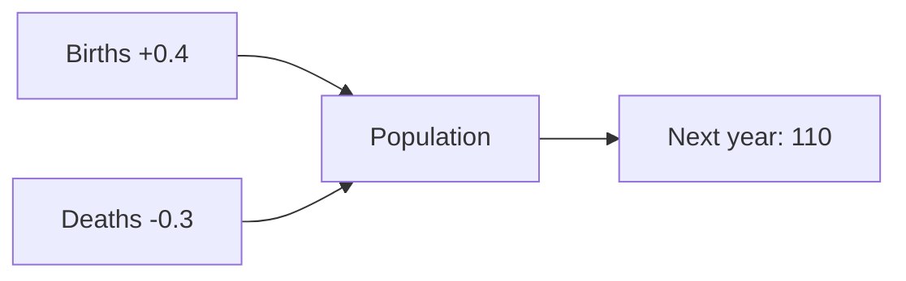

# Mechanistic Model

Explain a bathtub's water level by the tap and the drain: the level changes because water flows in at one rate and out at another, and each part of that explanation is a real thing you could measure separately. A **mechanistic model** (or process-based model) is built the same way, from the causes believed to produce the pattern, the *mechanisms*, so each of its parameters stands for a real biological process such as a birth rate or a death rate. Such parameters are called *interpretable*. Its opposite is a [[Phenomenological Model]], which describes a pattern without claiming to know its causes. Mechanistic does not mean complicated: one birth term and one death term is already mechanistic. It is usually the product of [[Theoretical Model|theoretical modeling]], reasoning from first principles about how a [[Model]] should work.

Example: population next year = this year × (1 + births − deaths). With 100 animals, a birth rate of 0.4 and a death rate of 0.3, next year holds 100 × 1.1 = 110, and after 10 years about 259. Now ask a what-if: protection halves the death rate to 0.15. Next year = 100 × (1 + 0.4 − 0.15) = 125. The model can answer because death is an explicit term in it; a curve merely fitted through past counts could not tell you what happens when mortality changes.

That is the great advantage. Describing a pattern is safe only inside the conditions you observed, but managers and climate researchers need predictions for conditions nobody has seen, and only a model that carries the causes can make that leap with any justification. Each parameter can also be checked against separate knowledge, such as a birth rate measured in another study. The price of that ambition is risk: if the assumed mechanism is wrong, the predictions are wrong, however good the fit. And mechanistic models still need data, because their parameters must be estimated. Hobbs and Hooten argue for deterministic models that express ecological ideas instead of generic curves ([[Hobbs and Hooten 2015 Ch2]], [[Deterministic Functions in Ecology]]), and the same thinking is the "process model" layer of a [[Hierarchical Model|hierarchical model]] ([[Process Model]], [[Population Dynamics]]).


*What to look at:* each arrow is a process with its own measurable rate.

```r
grow <- function(N, b, d) N * (1 + b - d)
grow(100, 0.4, 0.3)       # 110
grow(100, 0.4, 0.15)      # 125: a what-if about mortality
N <- 100; for (t in 1:10) N <- grow(N, 0.4, 0.3); N   # 259 after 10 years
```
Because deaths are an explicit term, the model can be asked about a change in deaths.

## Connections
- **Builds on:** [[Model]], [[Theoretical Model]]
- **Leads to:** [[Deterministic Functions in Ecology]], [[Process Model]], [[Population Dynamics]], [[Hierarchical Model]]
- **Part of:** [[MOC 02 - Modeling Foundations|MOC - Modeling Foundations]], molecular note [[Mechanistic vs Phenomenological Model]]

## Flashcards

What is a mechanistic model?
??
A model built from the processes thought to cause the pattern, with parameters that have biological meaning.
++++

What is the main advantage of a mechanistic model?
??
It can predict under new conditions, because the causes are explicit.
++++

What is its main risk?
??
If the assumed mechanism is wrong, the predictions are wrong.
++++
