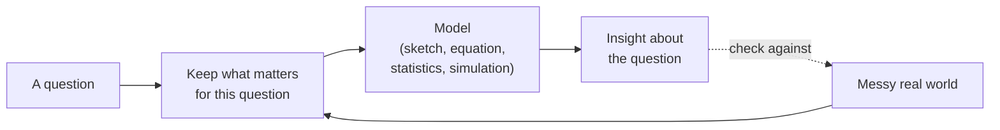

# Model

A map of the underground railway is "wrong" in almost every way: distances are off, bends are straightened, and the streets above are missing. Yet if your question is "which train gets me to the museum?", it is the most useful thing in your pocket, and it is useful *because* it leaves things out. A **model** is a deliberately simplified version of the real world, built to answer a particular question. You keep what the question needs and drop the rest on purpose, and the things you drop become *assumptions*, things the model takes as true without checking. Box and Draper's line sums it up: "[[Models as Abstractions|All models are wrong]], and some are useful" (quoted in [[Powell and Gale 2015 Ch1]]).

A tiny model: how many pine trees will there be next year? Write $N_{t+1} = N_t \times r$, where N is the number of trees, t means this year, t+1 next year, and r is the growth multiplier, a *parameter*, a fixed number that sets the model's exact behaviour ([[Parameter vs Estimate]]). With 500 trees and r = 1.04 (4% growth), next year has 500 × 1.04 = 520 trees. The model ignores fire, deer, drought and every tree's age. For a rough one-year projection that is fine; for planning a fire response you would need a different model. What to keep depends on the question: Powell and Gale ask how many balls fit in your room, where a rough guess ignores the desks but an engineer budgeting for balls would not.

So the test of a model is not "is it true?" but "is it useful for this question?". Models come in many forms, a sketch ([[Conceptual Model]]), an exact equation ([[Analytical Model]]), a formula fitted to data ([[Statistical Model]]) or a computer program ([[Simulation Model]]), and every regression or [[t-test]] is a statistical model even when software hides it. A model speaks about the simplified world you built, so you must *infer* back to nature, and that step is only as good as your simplifications; this is why assumptions get reported ([[Real World and Model World]], [[Modeling Process]]). More detail is not automatically better: a train map with every street would be worse ([[Parsimony]]). Wrong means simplified; useless means it cannot answer your question ([[Why model at all]]).


*What to look at:* the question decides what the model keeps, and insights are checked back against the real world.

```r
# A model can be as small as one line of R
next_year <- function(N, r) N * r
next_year(500, 1.04)                # 520 trees
round(500 * 1.04^(0:10))   # ten years of projection: 500, 520, 541, ...
```

## Connections
- **Builds on:** everyday maps and sketches, [[Models as Abstractions]]
- **Leads to:** [[Real World and Model World]], [[Conceptual Model]], [[Statistical Model]], [[Modeling Process]], [[Why model at all]], [[t-test]]
- **See also:** [[Course Schedule]], [[Exploration, Inference and Prediction]]
- **Part of:** [[MOC 02 - Modeling Foundations|MOC - Modeling Foundations]]
- **Go deeper:** [[Powell and Gale 2015 Ch1]]

## Flashcards

What is a model, in one sentence?
??
A simplification of the real world, built for a purpose, that lets you study the real world.
++++

What does "all models are wrong, and some are useful" mean?
??
Every model leaves things out on purpose, so none is literally true; the right question is whether it is useful for the question at hand.
++++

Why can the same room give different "how many balls fit" models?
??
Because what a model keeps depends on its purpose: a rough guess ignores furniture, a budget calculation must include it.
++++
