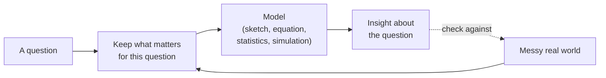

# Model

**In one line:** a model is a deliberately simplified version of the real world, built to answer a particular question. "All models are wrong, and some are useful" (Box and Draper 1987, quoted in [[Powell and Gale 2015 Ch1]], p. 1).

> [!info] Before this, it helps to know
> Nothing. This is the first idea of the course.

## The everyday picture
A map of the underground (subway) railway. It's "wrong" in almost every way: the distances are off, the bends are straightened, the streets and parks above are missing. Yet it's the most useful thing in your pocket if your question is "which train gets me to the museum?". It's useful *because* it leaves things out. A map that showed every brick would be useless.

A model is a map for a question. You keep what the question needs and drop the rest on purpose.

*Where the picture stops working:* a train map is drawn once and trusted. An ecological model is a guess about how nature works, so it has to be checked against data.

## Words you'll need
- **Model:** a simplified representation of a real system, made for a purpose.
- **Simplify:** to leave out detail on purpose.
- **Assumption:** something the model takes as true without checking, often the things you left out ("no fires this decade").
- **Parameter:** a fixed number inside a model that sets its exact behaviour, such as a growth rate ([[Parameter vs Estimate]]).
- **Inference:** the step from what the model says back to a claim about the real world.

## A tiny example
The question: how many pine trees will there be next year? The model: next year's trees = this year's trees × r, written $N_{t+1} = N_t × r$ ([[Powell and Gale 2015 Ch1]], p. 5). Here N is the number of trees, the little t means "this year", t+1 means "next year", and r is the growth multiplier.

With N = 500 trees and r = 1.04 (4% growth): 500 × 1.04 = **520 trees**.

What did the model leave out? Fire, deer browsing, drought, every individual tree's age. It's "wrong", and for a rough one-year projection it's useful. For planning a fire response, you'd need a different model.

## Start from zero
1. **The real world is too detailed to think about all at once.** A grassland has thousands of plants, weather every minute and birds moving all the time.
2. **So keep only the parts that matter for your question.** A road map leaves out trees and houses because you only need the roads. That kept-and-simplified picture is a model.
3. **What you keep depends on the question.** *Why:* Powell and Gale ask how many balls fit in your room. A rough guess ignores the desks. An engineer budgeting for balls would include them ([[Powell and Gale 2015 Ch1]], pp. 2 to 4). Same room, different purposes, different models.
4. **So every model is "wrong" on purpose.** The test isn't "is it true?" but "is it useful for this question?"
5. **Models come in many forms:** a sketch on paper ([[Conceptual Model]]), an equation ([[Analytical Model]]), a formula that learns from data ([[Statistical Model]]) or a computer program ([[Simulation Model]]).
6. **A model speaks about the simplified world you built, not directly about nature.** You then *infer* back to the real world ([[Real World and Model World]]). *Why it matters:* that inference is only as good as your simplifications, which is why you must report your assumptions ([[Modeling Process]]).

## See it

*What to look at:* the question decides what the model keeps, and insights are checked back against the real world.

## Why it is this way
Ecologists want to know *why* populations grow, shrink or move ([[Powell and Gale 2015 Ch1]], p. 1). A pile of field data can't answer "why" on its own. You need an explicit statement of how you think the numbers came about, and that statement is a model. Simplifying isn't a weakness to apologise for: it's the only way a human (or a computer with limited data) can think about a system at all. The skill is choosing *which* simplifications are safe for your question ([[Why model at all]]).

## In R
```r
# A model can be as small as one line of R
next_year <- function(N, r) N * r
next_year(500, 1.04)                # 520 trees
round(500 * 1.04^(0:10))   # ten years of projection: 500, 520, 541, ...
```

## In the course
This is the first session's question: "What is 'modeling?' and WHY model?" (Tue Aug 18, [[Course Schedule]]). Tredennick et al. add that a "best" model is only best *for some purpose*: exploration, inference or prediction ([[Exploration, Inference and Prediction]]).

## Common confusions
- **"A complicated model is a better model."** Not if the extra detail doesn't serve the question. A train map with every street would be worse, not better. See [[Parsimony]].
- **"Statistics isn't modeling."** Every regression, ANOVA or t-test is a statistical model, even when the software hides it ([[Statistical Model]]).
- **"Wrong means useless."** Wrong means simplified. Useless means it can't answer your question.

## Explain it back
- Use a train map to explain why a model leaves things out.
- What did the pine-tree model leave out, and when would that matter?
- Why can the same room give two different "how many balls" models?

*Pass test:* for any model you meet, you can name its question and one thing it deliberately ignores.

## Connections
- **Builds on:** everyday maps and sketches
- **Leads to:** [[Real World and Model World]], [[Conceptual Model]], [[Statistical Model]], [[Modeling Process]], [[Why model at all]]
- **Part of:** [[MOC 02 - Modeling Foundations|MOC - Modeling Foundations]]
- **Go deeper:** [[Powell and Gale 2015 Ch1]]

## Flashcards

What is a model, in one sentence?
??
A simplification of the real world, built for a purpose, that lets you study the real world.
++++

What does "all models are wrong, and some are useful" mean?
??
Every model leaves things out on purpose, so none is literally true; the right question is whether it is useful for the question at hand.
++++

Why can the same room give different "how many balls fit" models?
??
Because what a model keeps depends on its purpose: a rough guess ignores furniture, a budget calculation must include it.
++++
