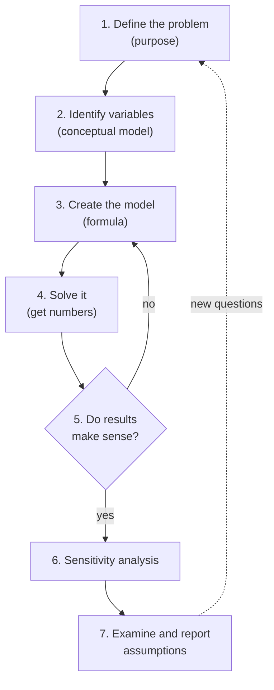

# Modeling Process

Planning a road trip, you first decide *why* you are going, because a quick visit and a scenic holiday need different plans. Then you list what matters, plan a route, work out the times, and sanity-check them: eight hours for 50 km means something is wrong. You ask "what if there is traffic?", and you note what you assumed, such as "the ferry runs on Sundays". The **modeling process** is the same sequence for models. Powell and Gale give Starfield's seven steps: define the problem, identify the important variables, create the model, solve it, interpret the results, run a sensitivity analysis, and examine and report the assumptions ([[Powell and Gale 2015 Ch1]]).

Work through one. Question: will a pine stand exceed 700 trees in 10 years? The variables are the current number of trees N₀ and the yearly growth multiplier r ([[Variable and Observation]]). The model is N₁₀ = N₀ × r¹⁰. Solving with N₀ = 500 and r = 1.04 gives about 740, so yes. Interpreting: that is plausible for a young stand, with no negative trees and no millions. The [[Sensitivity Analysis]] nudges r to 1.03, which gives about 672, and the answer flips to no; the conclusion hangs on r, so r is what to measure better next season. Finally the assumptions, no fire, constant r and no crowding, are reported beside the answer.

The order is not arbitrary; each step needs the one before. You cannot choose variables without a purpose, write a formula without variables, check results you have not calculated, or know which assumptions matter before seeing what the results depend on. The process is a loop, not a straight line: a nonsense result sends you back to rebuild the model, and a finished model usually raises a new question. "Interpret" means checking the answer makes biological sense, not just checking the arithmetic, and steps 6 and 7 are not optional extras; they are what make a model trustworthy, and reviewers ask about both. The same skeleton guides the [[Final Project]], and step 1 includes deciding whether the goal is exploration, inference or prediction ([[Exploration, Inference and Prediction]], [[Conceptual Model]], [[Model]]).


*What to look at:* step 5 loops back. Modeling is iterative, and the dotted line shows that a finished model usually raises the next question.

```r
N10 <- function(N0, r) N0 * r^10
N10(500, 1.04)     # step 4: about 740
N10(500, 1.03)     # step 6: about 672, so the conclusion is sensitive to r
```

## Connections
- **Builds on:** [[Model]], [[Conceptual Model]]
- **Leads to:** [[Sensitivity Analysis]], [[Data Exploration Protocol]], [[Why model at all]]
- **See also:** [[Analytical Model]], [[Real World and Model World]], [[Start Here]], [[Statistical Model]]
- **Part of:** [[MOC 02 - Modeling Foundations|MOC - Modeling Foundations]]
- **Go deeper:** [[Powell and Gale 2015 Ch1]]

## Flashcards

List Starfield's seven modeling steps.
??
1 Define the problem; 2 identify important variables; 3 create the model; 4 solve it; 5 interpret results; 6 sensitivity analysis; 7 examine and report assumptions.
++++

Why does defining the problem come first?
??
The model's purpose decides what to include and how detailed it must be; without it you cannot judge whether the model is good.
++++

Why do a thought-analysis of assumptions at the end?
??
Inference from the model to the Real World rests on the simplifications made; readers need them to judge the conclusions.
++++
