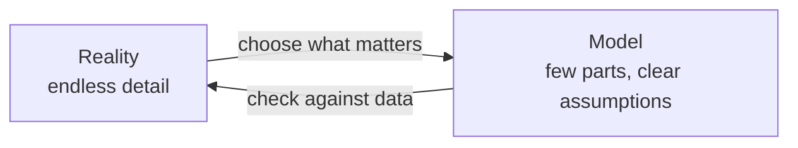

# Models as Abstractions

**In one line:** a model is an abstraction, a deliberately incomplete picture that keeps what matters for one question and drops the rest.

> [!info] Before this, it helps to know
> [[Model]] (a simplified description) · [[Real World and Model World]] (the two sides being compared)

## The everyday picture
A subway map. It ignores true distances, bends and street names, so as geography it is wrong. Yet it is perfect for one job: getting from station A to station B. A map as detailed as the city would be as useless as no map.

*Where the picture stops working:* a subway map was tested by millions of riders. A model's fitness for its job has to be checked by you.

## Words you'll need
- **Abstraction:** leaving out detail on purpose.
- **Assumption:** something the model treats as true to keep things simple.
- **Useful:** good enough for the question being asked.

## A tiny example
Model: "each nest survives a day with probability 0.95, independently".
- Over 20 days it predicts 0.95²⁰ = **0.36** survive to fledging.
- Wrong in detail: weather, predators and parents differ between nests.
- Useful: if 36 of 100 real nests fledge, the simple model captures what a manager needs.

## Start from zero
1. **Reality has endless detail.** No model can hold it all.
2. **So every model leaves things out.** In that sense every model is "wrong".
3. **The question decides what to keep.** *Why:* detail that doesn't change the answer only adds parameters to estimate.
4. **Judge a model by usefulness, not truth.** Does it predict, explain or guide a decision well enough?
5. **State the assumptions.** They are the list of what was left out, and the first place to look when the model fails.

## See it

*What to look at:* the arrow back to reality is what keeps an abstraction honest.

## Why it is this way
George Box's line, "all models are wrong but some are useful", is the working philosophy of the course. It frees you from searching for the true model, which doesn't exist, and points you at the real job: finding the simplest description that answers your question and admitting where it breaks.

## In R
```r
0.95^20                                  # 0.36: the simple model's prediction
set.seed(5)
# "reality": daily survival differs between nests (0.90 to 0.99)
p <- runif(1e4, 0.90, 0.99)
mean(rbinom(1e4, 1, p^20))               # about 0.37: the crude model is close
```
The model ignores real differences among nests and still lands near the truth.

## In the course
Powell and Gale open with models as simplifications built for a purpose ([[Powell and Gale 2015 Ch1]]). Anderson and Burnham add that "truth" is not in the candidate set ([[Anderson and Burnham 2002]]).

## Common confusions
- **"A wrong model is a useless model."** Wrong in detail and useful for a purpose go together.
- **"More detail makes a model truer."** It makes it harder to estimate and often worse at prediction ([[Overfitting]]).

## Explain it back
- Why is a subway map a good model and a bad map?
- What should you do with a model's assumptions?

*Pass test:* you can explain "all models are wrong but some are useful" with an example.

## Connections
- **Builds on:** [[Model]], [[Real World and Model World]]
- **Leads to:** [[Parsimony]], [[Model Complexity]], [[Full Reality]]
- **Part of:** [[MOC 02 - Modeling Foundations|MOC - Modeling Foundations]], molecular note [[Why model at all]]

## Flashcards

What does "all models are wrong but some are useful" mean?
??
Every model leaves out detail, so none is literally true, but a model can still answer a specific question well.
++++

What decides which details a model should keep?
??
The question it is built to answer.
++++

Why state a model's assumptions?
??
They list what was left out and show where the model is likely to fail.
++++
