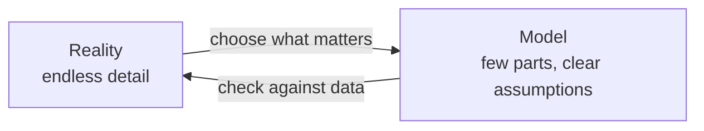

# Models as Abstractions

A subway map ignores true distances, bends and street names, so as a map of the city it is wrong. Yet it is perfect for one job: getting from station A to station B. A map as detailed as the city itself would be as useless as no map at all. That is the sense in which a [[Model]] is an **abstraction**: a deliberately incomplete picture that keeps what matters for one question and leaves the rest out on purpose. Whatever the model treats as true to keep things simple is an *assumption*. Because reality has endless detail and no model can hold it all, every model is "wrong" in detail; George Box's line, "all models are wrong but some are useful", is the working philosophy of this course.

A small example. Model: "each nest survives each day with probability 0.95, independently of the others". Over a 20-day nesting period it predicts that 0.95²⁰ = 0.36 of nests survive to fledging. That is wrong in detail, because weather, predators and parents differ from nest to nest. But if about 36 of 100 real nests fledge, the simple model captures exactly what a manager needs. A quick simulation makes the point: let each nest's daily survival vary anywhere between 0.90 and 0.99, and the true fledging rate comes out near 0.37, close to the crude model's answer.

So the question decides what a model keeps. Detail that does not change the answer only adds parameters you must estimate from limited data, and more detail does not make a model truer; it makes it harder to estimate and often worse at prediction ([[Overfitting]], [[Model Complexity]], [[Parsimony]]). Judge a model by usefulness, not truth: does it predict, explain or guide a decision well enough? And always state the assumptions, because they are the list of what was left out and the first place to look when the model fails. This frees you from searching for the one true model, which does not exist (Anderson and Burnham stress that "truth" is never in the candidate set, [[Anderson and Burnham 2002]], [[Full Reality]]), and points you at the real job: the simplest description that answers your question, checked against data from the [[Real World and Model World|real world]]. Powell and Gale open their book the same way ([[Powell and Gale 2015 Ch1]]).


*What to look at:* the arrow back to reality is what keeps an abstraction honest.

```r
0.95^20                                  # 0.36: the simple model's prediction
set.seed(5)
# "reality": daily survival differs between nests (0.90 to 0.99)
p <- runif(1e4, 0.90, 0.99)
mean(rbinom(1e4, 1, p^20))               # about 0.37: the crude model is close
```
The model ignores real differences among nests and still lands near the truth.

## Connections
- **Builds on:** [[Model]], [[Real World and Model World]]
- **Leads to:** [[Parsimony]], [[Model Complexity]], [[Full Reality]]
- **Part of:** [[MOC 02 - Modeling Foundations|MOC - Modeling Foundations]], molecular note [[Why model at all]]

## Flashcards

What does "all models are wrong but some are useful" mean?
??
Every model leaves out detail, so none is literally true, but a model can still answer a specific question well.
++++

What decides which details a model should keep?
??
The question it is built to answer.
++++

Why state a model's assumptions?
??
They list what was left out and show where the model is likely to fail.
++++
