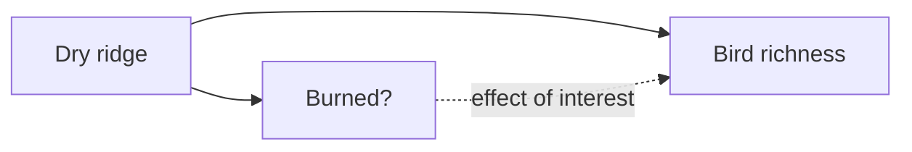

# Observational Study

Compare the health of people who choose to jog with people who do not. Joggers may well be healthier, but they also differ in diet, age and income, and you only watched; you did not decide who jogged. An **observational study** (also called a mensurative study) measures things as they are, without the researcher deciding which unit gets which condition. Nature or people set the conditions, so the groups being compared differ in more than the factor you care about. Plots do not choose to burn, but whatever decided which plots burned plays the same troublesome role as the joggers' choice.

An example. Of 30 plots, 15 happened to [[Burn-in|burn in]] wildfires and 15 did not. Burned plots average 9 bird species and unburned plots 6. But wildfires started more often on drier ridges, and dry ridges may suit grassland birds anyway, so the 3-species gap mixes fire with ridge. A variable that drives both the supposed cause and the response like this is a [[Confounding|Confounding Variable]]. You can adjust for it if you measured it, by putting dryness into the model as a covariate, but never for what you did not measure. A simulation shows the danger: if dryness raises [[Species Richness|richness]] and makes plots more likely to burn, while fire itself does nothing, a model of richness on burning alone reports a clear "fire effect", which vanishes once dryness is included.

Most ecological data, and nearly all the course datasets, are observational, because you cannot randomly assign latitude, climate or wildfire. That is their strength as well: realism and scale, whole landscapes over decades, which no experiment can match. Knowing their limits explains why the course stresses hypotheses stated in advance, careful choice of covariates and cautious wording ([[Correlation vs Causation]], [[Guthery and Bingham 2007]]). Observational studies are not worthless for learning causes; their evidence is weaker, and it grows stronger with replication across systems and with a plausible mechanism. And adding covariates removes confounding only by the variables you measured, and measured well. The contrast is the [[Experimental Study]], where the researcher assigns conditions; both need a sound [[Study Design]].


*What to look at:* the ridge has arrows into both, so the dotted arrow can't be read cleanly.

```r
set.seed(5)
dry <- rnorm(200)
burned <- rbinom(200, 1, plogis(1.5 * dry))        # dry plots burn more often
birds <- rpois(200, exp(1.8 + 0.3 * dry))          # dryness raises richness; fire does nothing
coef(glm(birds ~ burned, family = poisson))        # "fire effect" appears
coef(glm(birds ~ burned + dry, family = poisson))  # vanishes once dryness is included
```
Fire had no effect in this simulation. The first model invented one.

## Connections
- **Builds on:** [[Study Design]]
- **Leads to:** [[Confounding|Confounding Variable]], [[Experimental Study]], [[Correlation vs Causation]], [[Burn-in]], [[Species Richness]]
- **See also:** [[Predictor Variable|Explanatory Variable]]
- **Part of:** [[MOC 02 - Modeling Foundations|MOC - Modeling Foundations]], molecular note [[Observational vs Experimental Study]]

## Flashcards

What makes a study observational?
??
The researcher measures conditions as they occur and does not assign them.
++++

Why are causal claims from observational data tentative?
??
Groups may differ in unmeasured ways that also affect the response.
++++

What can statistical adjustment fix in observational data?
??
Confounding by variables that were measured and included, not unmeasured ones.
++++
