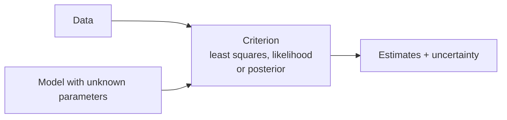

# Parameter Estimation

Tuning an old radio, you turn the dial until the signal is clearest. The station's frequency is a fixed fact you do not know, and you find it by searching for the setting that works best. **Parameter estimation** is turning a model's dials the same way: using data to work out plausible values for the unknown numbers in a model, its [[Parameter]]s. Doing this is called *fitting* the model. It needs three ingredients: data, a model with unknown parameters, and a *criterion* that says what "best" means, because without one no setting is better than another. The recipe that produces the answer is an [[Estimator]], and the answer is an [[Estimate]], reported together with an interval saying how sure you are.

A worked example. Ten nests are watched and 7 survive. Model: each nest survives with an unknown probability p. Try some values and ask how probable the observed result would be under each. With p = 0.5 the chance of seeing exactly 7 of 10 is 0.117; with p = 0.7 it is 0.267; with p = 0.9 it is 0.057. The value 0.7 makes the data most probable, so it is the estimate, with a standard error of √(0.7 × 0.3 / 10) = 0.145. Values near 0.7 fit almost as well, and that set of nearly-as-good values is what an interval reports. A radio has one dial and a clear peak; real models have many dials, and even the best setting carries doubt.

Three criteria for "best" run through the course: [[Least Squares]] (smallest squared errors), [[Maximum Likelihood Estimation]] (the values that make the data most probable, as in the nest example), and the Bayesian posterior, which combines the likelihood with prior knowledge ([[Bayesian Inference]]). R's fitting functions do the search for you and report each estimate with its uncertainty. Estimation is what connects a model to the world: a model with unknown numbers says nothing specific. It is the backbone of Powell and Gale's book, because abundance, survival and occupancy cannot be observed directly and must be estimated ([[Powell and Gale 2015 Ch2]], [[Powell and Gale 2015 Ch3]]); Hobbs and Hooten develop likelihood and Bayesian estimation ([[Hobbs and Hooten 2015 Ch4]], [[Hobbs and Hooten 2015 Ch5]]). Estimation never finds the true value, only a plausible value and a range, and an estimate without its uncertainty is half a result.


*What to look at:* data and model meet at a criterion, and estimates come out.

```r
dbinom(7, 10, c(0.5, 0.7, 0.9))            # 0.117 0.267 0.057
p <- seq(0.01, 0.99, 0.01)
p[which.max(dbinom(7, 10, p))]              # 0.7
m <- glm(cbind(7, 3) ~ 1, family = binomial)
plogis(coef(m)); plogis(confint.default(m)) # estimate and a rough 95% interval
```
R's fitting functions do this search for you and report estimate plus uncertainty.

## Connections
- **Builds on:** [[Parameter]], [[Estimator]], [[Estimate]]
- **Leads to:** [[Least Squares]], [[Maximum Likelihood Estimation]], [[Bayesian Inference]]
- **Part of:** [[MOC 02 - Modeling Foundations|MOC - Modeling Foundations]], molecular note [[Parameter vs Estimate]]

## Flashcards

What is parameter estimation?
??
Using data to find plausible values, with uncertainty, for a model's unknown parameters.
++++

What three ingredients does estimation need?
??
Data, a model with unknown parameters, and a criterion for "best".
++++

Name three estimation criteria used in the course.
??
Least squares, maximum likelihood, and the Bayesian posterior.
++++
