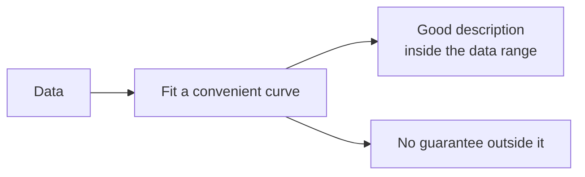

# Phenomenological Model

**In one line:** a phenomenological model describes the pattern in the data without claiming to represent the processes behind it.

> [!info] Before this, it helps to know
> [[Empirical Model]] (models driven by data) · [[Linear Regression]] (the most common example)

## The everyday picture
A tailor measuring a customer. The tailor records the shape accurately and makes a suit that fits. They neither know nor care why the customer has that shape. Good fit, no explanation.

*Where the picture stops working:* a body barely changes. A fitted pattern can change completely when conditions change.

## Words you'll need
- **Pattern:** a regular relationship seen in data.
- **Curve fitting:** choosing a flexible shape that follows the data.
- **Interpolation:** predicting within the range of the data.

## A tiny example
Bird richness falls by 1.5 species per 10% tree cover, fitted across 10% to 50% cover.
- At 30% cover the line predicts well: that is inside the data.
- At 90% cover it predicts a negative number of species. The line described a pattern. It never knew why.

## Start from zero
1. **Collect paired data.** Cover and richness.
2. **Pick a convenient shape.** A line, a polynomial, a smooth curve.
3. **Fit it.** The coefficients summarise the pattern.
4. **Use it inside the range you sampled.** *Why:* the shape was chosen for convenience, so nothing guarantees it outside.
5. **Treat it as a clue to mechanism, not proof.**

## See it

*What to look at:* the model's authority ends where the data end.

## Why it is this way
Often the mechanism is unknown or too complex, and a clear description is exactly what is needed: is there a trend, how strong, how uncertain? Most regressions, GLMs and GAMs in the course are phenomenological. That is fine, as long as you don't ask them to explain or to extrapolate.

## In R
```r
d <- data.frame(tree = c(10, 20, 30, 40, 50), birds = c(9, 8, 6, 5, 3))
m <- lm(birds ~ tree, d)
predict(m, data.frame(tree = 30))    # 6.2: sensible, inside the data
predict(m, data.frame(tree = 90))    # -2.8: nonsense, outside the data
```
The line fits well and still fails once you leave the range it was built on.

## In the course
GAMs are the most flexible phenomenological tool in the course ([[Generalized Additive Model]]). Guthery and Bingham caution against reading mechanism into regression coefficients ([[Guthery and Bingham 2007]]).

## Common confusions
- **"Phenomenological means bad."** It means descriptive. It is often the right tool.
- **"A good fit shows the mechanism."** Many mechanisms can produce the same curve.

## Explain it back
- Why did the line predict negative species at 90% cover?
- When is a purely descriptive model the right choice?

*Pass test:* you can say why a fitted curve can't be trusted far outside its data.

## Connections
- **Builds on:** [[Empirical Model]]
- **Leads to:** [[Extrapolation]], [[Generalized Additive Model]], [[Correlation vs Causation]]
- **Part of:** [[MOC 02 - Modeling Foundations|MOC - Modeling Foundations]], molecular note [[Mechanistic vs Phenomenological Model]]

## Flashcards

What is a phenomenological model?
??
A model that describes a pattern in data without representing the processes that cause it.
++++

Where can a phenomenological model be trusted?
??
Inside the range of conditions the data covered.
++++

Does a good fit reveal the mechanism?
??
No. Different mechanisms can produce the same pattern.
++++
