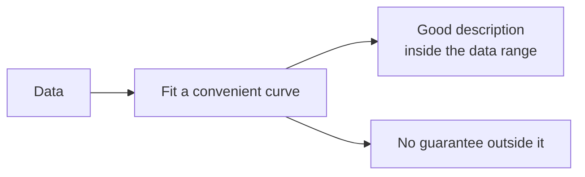

# Phenomenological Model

A tailor measures a customer and makes a suit that fits perfectly, without knowing or caring why the customer has that shape. Good fit, no explanation. A **phenomenological model** (or descriptive model) is like that tailor: it describes a *pattern*, a regular relationship seen in data, without claiming to represent the processes behind it. You collect paired data, pick a convenient shape (a [[Equation of a Line|straight line]], a polynomial, a smooth curve), and fit it; this is *curve fitting*, and the fitted coefficients summarise the pattern. Most regressions, [[Generalized Linear Model|GLMs]] and GAMs in the course are phenomenological, and they usually come from [[Empirical Model|empirical modeling]], where the data lead.

Here is both the strength and the limit. Bird [[Species Richness|richness]] falls by about 1.5 species per 10% of tree cover, fitted to plots with 10% to 50% cover. At 30% cover the line predicts 6.2 species, a sensible value because 30% lies inside the data; predicting inside the range of the data is *interpolation*. At 90% cover the same line predicts −2.8 species, which is impossible. The line described a pattern and never knew why the pattern exists, so nothing guarantees its shape outside the range it was built on. Predicting beyond the data is [[Extrapolation]], and a phenomenological model's authority ends where the data end. A body barely changes, so a suit keeps fitting, but a fitted pattern can change completely when conditions change.

Phenomenological does not mean bad. Often the mechanism is unknown or too complex, and a clear description is exactly what is needed: is there a trend, how strong is it, how uncertain? The most flexible descriptive tool in the course is the [[Generalized Additive Model]], which lets the data draw the curve. Two cautions keep these models honest. Do not ask them to extrapolate, and do not read mechanism into a good fit, because many different mechanisms can produce the same curve; treat the pattern as a clue to the cause, not proof of it ([[Correlation vs Causation]]). Guthery and Bingham warn against reading mechanism into regression coefficients for exactly this reason ([[Guthery and Bingham 2007]]). Compare the [[Mechanistic Model]], which is built from causes.


*What to look at:* the model's authority ends where the data end.

```r
d <- data.frame(tree = c(10, 20, 30, 40, 50), birds = c(9, 8, 6, 5, 3))
m <- lm(birds ~ tree, d)
predict(m, data.frame(tree = 30))    # 6.2: sensible, inside the data
predict(m, data.frame(tree = 90))    # -2.8: nonsense, outside the data
```
The line fits well and still fails once you leave the range it was built on.

## Connections
- **Builds on:** [[Empirical Model]], [[Equation of a Line]]
- **Leads to:** [[Extrapolation]], [[Generalized Additive Model]], [[Correlation vs Causation]], [[Generalized Linear Model]], [[Species Richness]]
- **See also:** [[Linear Regression]]
- **Part of:** [[MOC 02 - Modeling Foundations|MOC - Modeling Foundations]], molecular note [[Mechanistic vs Phenomenological Model]]

## Flashcards

What is a phenomenological model?
??
A model that describes a pattern in data without representing the processes that cause it.
++++

Where can a phenomenological model be trusted?
??
Inside the range of conditions the data covered.
++++

Does a good fit reveal the mechanism?
??
No. Different mechanisms can produce the same pattern.
++++
