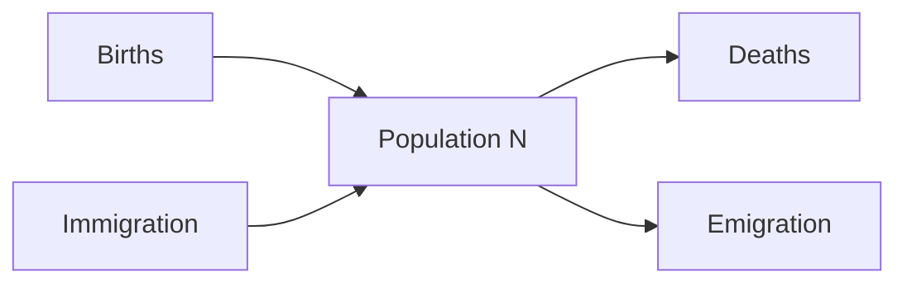

# Population Dynamics

A bank balance changes only through deposits and withdrawals. A population is the same: its size can change in only four ways. The two deposits are births and immigrants (animals arriving from elsewhere); the two withdrawals are deaths and emigrants (animals leaving). **Population dynamics** is the study of how and why the size of a [[Biological Population]] changes over time through those four processes. A bank statement lists every transaction, but wildlife transactions are hidden and must be estimated, which is why so much of the course is about estimating them.

Written as an equation, N next year = N + B − D + I − E, where N is this year's number, B births, D deaths, I immigrants and E emigrants. This is called the BIDE equation. With 100 deer this year, 30 births, 20 deaths, 5 arrivals and 10 departures, next year holds 100 + 30 − 20 + 5 − 10 = 105 deer. The ratio 105 / 100 = 1.05 is the [[Population Growth Rate]] λ, and if it stayed at 1.05 the herd would reach about 163 in ten years ([[Rate of Change]]). The BIDE equation is bookkeeping, so it is always true: there are no other ways in or out. The science lies in what drives each term, such as weather, density, harvest and habitat.

Managers want to know not just how many animals there are but why the number is changing and which lever to pull, and splitting change into its four components shows where to look. Each component is a parameter that some chapter of Powell and Gale teaches you to estimate: [[Survival Rate]], [[Fecundity]], and movement ([[Powell and Gale 2015 Ch1]]). Two confusions are common. A stable count does not mean nothing is happening, because high births can be offsetting high deaths, or immigration can be hiding a local decline. And survival alone cannot tell you the trend; you need all four components. Whether immigration and emigration can be ignored is the question of [[Open vs Closed Populations]].


*What to look at:* two arrows in, two arrows out.

```r
N <- 100; B <- 30; D <- 20; I <- 5; E <- 10
N_next <- N + B - D + I - E; N_next       # 105
N_next / N                                # lambda = 1.05
round(100 * 1.05^(0:10))                  # ten years at that rate
```
Constant λ of 1.05 turns 100 deer into 163 in ten years.

## Connections
- **Builds on:** [[Biological Population]], [[Rate of Change]]
- **Leads to:** [[Population Growth Rate]], [[Survival Rate]], [[Fecundity]], [[Open vs Closed Populations]]
- **Part of:** [[MOC 02 - Modeling Foundations|MOC - Modeling Foundations]]

## Flashcards

What four processes change population size?
??
Births, deaths, immigration and emigration.
++++

Write the BIDE equation.
??
N next = N + B − D + I − E.
++++

Why can a stable count hide a problem?
??
High recruitment can mask high mortality, or immigration can mask local decline.
++++
