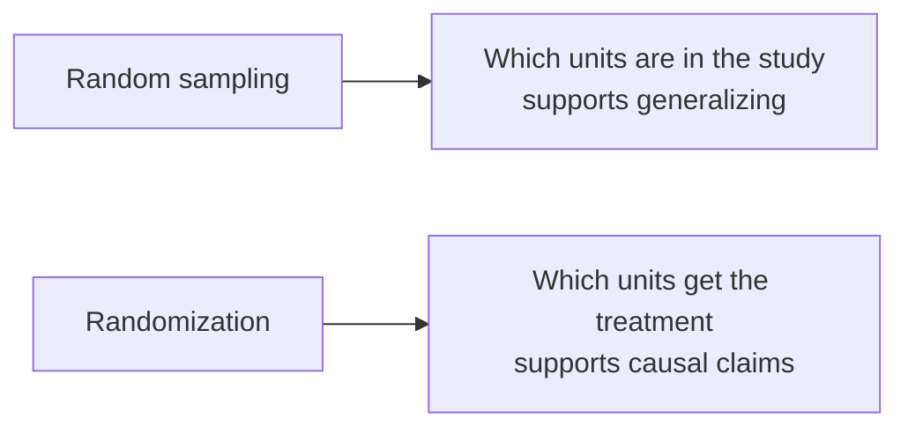

# Randomization

**In one line:** randomization means letting chance decide which units receive which treatment.

> [!info] Before this, it helps to know
> [[Random Sampling]] (chance decides which units are in the study) · [[Experimental Study]] (the researcher assigns conditions)

## The everyday picture
Picking teams by drawing straws instead of letting captains choose. Captains would stack their sides. Straws don't know who is fast, so over many games neither side has a built-in edge.

*Where the picture stops working:* with only a few players, straws can still give lopsided teams by luck.

## A tiny example
8 plots, 4 to be burned. Their dryness scores: 1, 2, 3, 4, 5, 6, 7, 8.
- Manager's choice: burn the four driest (5, 6, 7, 8). Mean dryness 6.5 against 2.5. Hopelessly confounded.
- Random draw, say plots 2, 3, 6, 8: mean 4.75 against 4.25. Nearly balanced, and nobody planned it.

## Start from zero
1. **List the units.**
2. **Use a random number generator to assign treatments.**
3. **Assignment is now unrelated to every property of the units.** *Why:* the generator knows nothing about them.
4. **So known and unknown nuisance variables are balanced on average.**
5. **Small experiments can be unlucky.** Blocking, which randomizes within matched sets, guards against that.
6. **It differs from random sampling.** Sampling decides who is studied (and to whom results apply). Randomization decides who gets what (and whether effects are causal).

## See it

*What to look at:* two uses of chance, answering two different questions.

## Why it is this way
Any rule a person uses to assign treatments, even an unconscious one, can correlate with the outcome. Chance is the only assignment rule guaranteed to be unrelated to everything. It also makes the probability statements of tests literally true.

## In R
```r
set.seed(42)
dry <- 1:8
burn <- sample(rep(c(TRUE, FALSE), 4))        # random assignment
tapply(dry, burn, mean)                       # roughly balanced
# over many randomizations the difference averages zero
mean(replicate(5000, {b <- sample(rep(c(TRUE, FALSE), 4)); mean(dry[b]) - mean(dry[!b])}))
```
Any one draw is imperfect. On average the groups are identical.

## In the course
Part of the design critique in Homework 4 ([[Course Website]]).

## Common confusions
- **"Randomization and random sampling are the same."** One assigns treatments, the other selects units.
- **"Random assignment guarantees balance."** Only on average. Check, and block if units are few.

## Explain it back
- What can go wrong when a person chooses which plots to treat?
- How does randomization differ from random sampling?

*Pass test:* you can randomize treatments in R and say what that buys.

## Connections
- **Builds on:** [[Random Sampling]], [[Experimental Study]]
- **Leads to:** [[Control Group]], [[Confounding Variable]], [[Replication]]
- **Part of:** [[MOC 02 - Modeling Foundations|MOC - Modeling Foundations]]

## Flashcards

What is randomization?
??
Assigning treatments to units by a chance mechanism.
++++

What does randomization protect against?
??
Confounding by any variable, known or unknown, that might otherwise line up with treatment.
++++

How does randomization differ from random sampling?
??
Randomization decides which units get which treatment. Random sampling decides which units are studied.
++++
