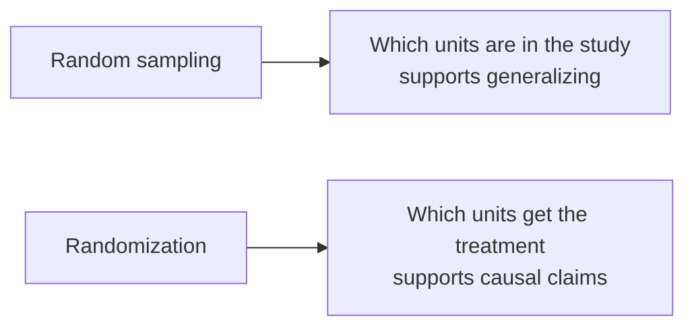

# Randomization

Picking teams by drawing straws instead of letting captains choose stops the captains from stacking their sides. Straws do not know who is fast, so over many games neither side has a built-in edge. **Randomization** (random assignment) means letting chance decide which units receive which treatment in an [[Experimental Study]]. Because a [[Random Numbers and set.seed()|random number generator]] knows nothing about the units, the assignment is unrelated to every property they have, so nuisance variables, known and unknown, are balanced between groups on average. With only a few units, straws can still produce lopsided teams by bad luck.

Eight plots have dryness scores 1 to 8, and four will be burned. If a manager chooses, say, the four driest (5, 6, 7, 8), their mean dryness is 6.5 against 2.5 for the rest, and burning and dryness are hopelessly confounded. A random draw, say plots 2, 3, 6 and 8, gives means of 4.75 against 4.25: nearly balanced, and nobody planned it. Over thousands of random draws the difference averages exactly zero. Any single draw is imperfect, though, so check the balance, and when units are few use [[Blocking|blocking]], which randomizes within matched sets of similar units.

Why insist on chance? Because any rule a person uses to assign treatments, even an unconscious one, can correlate with the outcome, creating a [[Confounding|Confounding Variable]]. Chance is the only assignment rule guaranteed to be unrelated to everything, and it also makes the probability statements of statistical tests literally true. Do not confuse it with [[Random Sampling]]: random sampling decides which units are in the study, which supports generalizing to a population, while randomization decides which units get the treatment, which supports causal claims. Both uses of chance appear in a good design, alongside a [[Control Group]] and [[Replication]].


*What to look at:* two uses of chance, answering two different questions.

```r
set.seed(42)
dry <- 1:8
burn <- sample(rep(c(TRUE, FALSE), 4))        # random assignment
tapply(dry, burn, mean)                       # roughly balanced
# over many randomizations the difference averages zero
mean(replicate(5000, {b <- sample(rep(c(TRUE, FALSE), 4)); mean(dry[b]) - mean(dry[!b])}))
```
Any one draw is imperfect. On average the groups are identical.

## Connections
- **Builds on:** [[Random Sampling]], [[Experimental Study]]
- **Leads to:** [[Control Group]], [[Confounding|Confounding Variable]], [[Replication]], [[Random Numbers and set.seed()]], [[Blocking]]
- **Part of:** [[MOC 02 - Modeling Foundations|MOC - Modeling Foundations]]

## Flashcards

What is randomization?
??
Assigning treatments to units by a chance mechanism.
++++

What does randomization protect against?
??
Confounding by any variable, known or unknown, that might otherwise line up with treatment.
++++

How does randomization differ from random sampling?
??
Randomization decides which units get which treatment. Random sampling decides which units are studied.
++++
