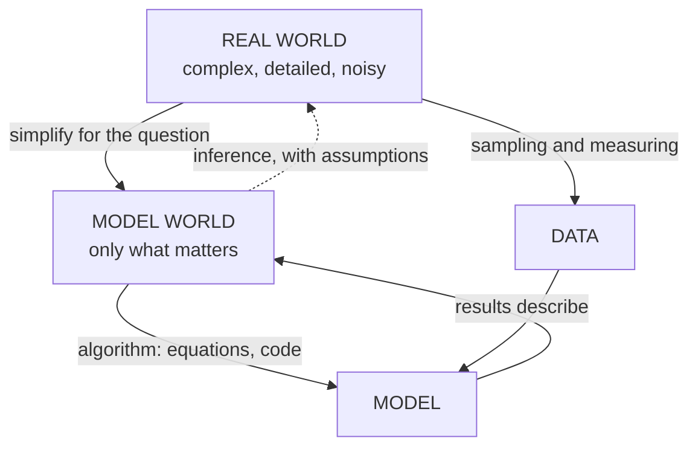

# Real World and Model World

An architect builds a cardboard model of a new house, with walls, windows and a roof but no plumbing, wiring or weather. She can test things on it: does the sun reach the kitchen in the morning? Shine a torch and see. But the answer is about the *cardboard* house, and whether the real kitchen gets sun depends on whether the cardboard left out something important, like the neighbour's tall tree. Powell and Gale, following Starfield, lay out modeling the same way ([[Powell and Gale 2015 Ch1]]). The **Real World** is nature in all its "bumpy, detailed, curvy, dirty, complex" detail. The **Model World** is a simplified version keeping only what your question needs. The **Model** is the Model World turned into an *algorithm*, a formula or step-by-step recipe. **Data** collected in the Real World give the model its numbers, and *inference* is the careful step from the model's results back to a claim about the Real World.

Follow a pine stand through the loop. The Real World has fire, deer, drought and 500 trees of many ages. The Model World has 500 identical trees, no fire, and steady 4% growth a year. The Model is $N_{t+1} = N_t \times 1.04$, and the Data are today's count of 500. The output, 500 × 1.04¹⁰ ≈ 740 trees in 10 years, is a fact about the Model World. The inference to the Real World is "*if* fire stays absent and growth stays near 4%, expect about 740 trees", and the "if" carries the Model World's assumptions back with it. That is why the simplifications must be listed as assumptions ([[Modeling Process]]).

This picture solves a puzzle that trips up beginners: how can a model fit the data beautifully and still be wrong? A good fit shows only that the Model World is consistent with the data you fed it; it cannot show that you kept the right pieces of reality. [[Model Validation|Model checking]], such as [[Posterior Predictive Check|posterior predictive checks]] and [[DHARMa Simulated Residuals|residual diagnostics]], is how the Real World gets a chance to push back. Two related confusions: the model tells you about your simplified version of nature, not about nature directly, and data are not the Real World either, only a sample of it collected by a method that can leave things out ([[Biological vs Statistical Population]]). Hobbs and Hooten describe the same path as a "[[Line of Inference|line of inference]]" ending in "new insight qualified by uncertainty" ([[Hobbs and Hooten 2015 Ch1]], [[Model]]).


*What to look at:* there is no arrow straight from the Model to the Real World. Every conclusion passes through the Model World and its assumptions (after Donovan and Starfield 2015, in [[Powell and Gale 2015 Ch1]], Fig. 1.4).

```r
N0 <- 500; r <- 1.04
N10 <- N0 * r^10      # the model's answer about the Model World
round(N10)            # about 740
```

## Connections
- **Builds on:** [[Model]], [[Line of Inference]]
- **Leads to:** [[Conceptual Model]], [[Modeling Process]], [[Population and Sample]], [[Model Validation]]
- **Part of:** [[MOC 02 - Modeling Foundations|MOC - Modeling Foundations]]
- **Go deeper:** [[Powell and Gale 2015 Ch1]] (Fig. 1.4)

## Flashcards

Why does a model not inform us directly about the Real World?
??
It was built from the simplified Model World; conclusions about the Real World are inferences that rest on the simplifying assumptions.
++++

In the Starfield framework, where do the model's numbers come from?
??
From data collected in the Real World (e.g., counts for N, births and deaths for r).
++++

How can a model fit the data well and still be wrong?
??
A good fit only shows the Model World is consistent with the data; it can't show that the parts left out didn't matter.
++++
