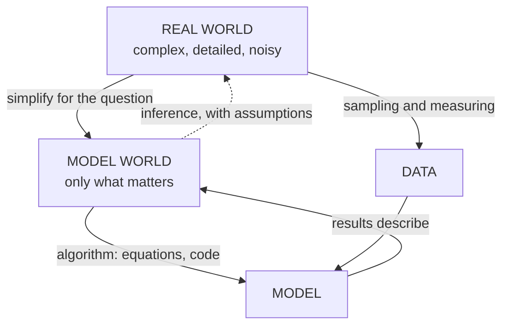

# Real World and Model World

**In one line:** you build a simplified **Model World** from the messy **Real World**, turn it into a **Model**, feed the model **Data** from the Real World, and then reason back to the Real World, remembering that the model only ever described the Model World.

> [!info] Before this, it helps to know
> [[Model]] (a purposeful simplification)

## The everyday picture
An architect's cardboard model of a new house. On the table, the model house has walls, windows and a roof, but no plumbing, no wiring, no weather. The architect can test things on it: "does the sun reach the kitchen in the morning?" Shine a torch and see. But the answer is about the **cardboard** house. Whether the real kitchen gets sun depends on whether the cardboard left out anything important, like the neighbour's tall tree.

That's the whole idea. The Real World is the plot of land with the tree. The Model World is the architect's simplified idea of it. The cardboard house is the Model. Conclusions about the real house are a careful step back from the cardboard.

*Where the picture stops working:* an architect can walk outside and look at the tree. In ecology the parts you left out are often things you can't easily see.

## Words you'll need
- **Real World:** nature as it actually is, with all its detail.
- **Model World:** the simplified version in your head or on paper, with only the parts your question needs.
- **Model:** the Model World turned into equations, code or a statistical formula.
- **Algorithm:** a step-by-step recipe or formula; here, the rules of the model.
- **Data:** measurements collected in the Real World and fed into the model.
- **Inference:** reasoning from the model's results back to a claim about the Real World.
- **Assumption:** a simplification you made, stated as something you're taking to be true.

## A tiny example
- **Real World:** a pine stand with fire, deer, drought and 500 trees of many ages.
- **Model World:** 500 identical trees, no fire, a steady 4% growth each year.
- **Model:** $N_{t+1} = N_t × 1.04$.
- **Data:** a count of 500 trees today.
- **Model output:** 500 × 1.04¹⁰ ≈ **740 trees** in 10 years. This is a fact about the Model World.
- **Inference to the Real World:** "*if* fire stays absent and growth stays near 4%, expect about 740 trees". The "if" carries the Model World's assumptions back with it.

## Start from zero
1. **The Real World is "bumpy, detailed, curvy, dirty, complex"**, with far more information than you can use ([[Powell and Gale 2015 Ch1]], p. 4).
2. **You build a Model World by removing most of it.** In Powell and Gale's example the fish and islands are gone, and the trees and lake are kept, because the question is about trees. *Why:* you can only reason clearly about a few things at once.
3. **You turn the Model World into a Model using an algorithm**, a formula or procedure such as $N_{t+1} = N_t × r$.
4. **The model's numbers come from Data collected in the Real World.** Count trees to get N; measure births and deaths to get r = b − d ([[Powell and Gale 2015 Ch1]], p. 5).
5. **The model's output describes the Model World.** *Why this matters:* the model never saw the parts you left out. Any conclusion about the Real World is an inference that assumes those parts didn't matter much.
6. **So list your simplifications.** They are your assumptions, and readers need them to judge your inference ([[Modeling Process]], step 7).

## See it

*What to look at:* there is no arrow straight from the Model to the Real World. Every conclusion passes through the Model World and its assumptions (after Donovan and Starfield 2015, in [[Powell and Gale 2015 Ch1]], Fig. 1.4).

## Why it is this way
This picture explains a puzzle that trips up beginners: how can a model fit the data beautifully and still be wrong? A good fit only shows that the Model World is internally consistent with the data you fed it. It can't show that you kept the right pieces of reality. That's why model checking ([[Posterior Predictive Check]], [[DHARMa Simulated Residuals|Residual Diagnostics with DHARMa]]) matters: it's how the Real World gets a chance to push back on the Model World.

## In R
```r
N0 <- 500; r <- 1.04
N10 <- N0 * r^10      # the model's answer about the Model World
round(N10)            # about 740
```

## In the course
Powell and Gale's framework (after Starfield) is the course's opening picture of what modeling is ([[Powell and Gale 2015 Ch1]], pp. 4 to 5). Hobbs and Hooten describe the same idea as a "line of inference" running from theory to "new insight qualified by uncertainty" ([[Hobbs and Hooten 2015 Ch1]], Fig. 1.1.1).

## Common confusions
- **"The model tells me about nature."** It tells you about your simplified version of nature. The step to nature is an inference.
- **"Data are the Real World."** Data are a sample of it, collected with a method that can itself leave things out ([[Biological vs Statistical Population]]).
- **"A good fit proves the model is right."** It shows the Model World fits these data, not that nothing important was left out.

## Explain it back
- Use the architect's cardboard house to explain the Real World, Model World and Model.
- Why is there no arrow straight from the model to the Real World?
- In the pine example, which assumption travels with the "740 trees" answer?

*Pass test:* you can take any model result and add the right "if..." in front of it.

## Connections
- **Builds on:** [[Model]]
- **Leads to:** [[Conceptual Model]], [[Modeling Process]], [[Population and Sample]]
- **Part of:** [[MOC 02 - Modeling Foundations|MOC - Modeling Foundations]]
- **Go deeper:** [[Powell and Gale 2015 Ch1]] (Fig. 1.4)

## Flashcards

Why does a model not inform us directly about the Real World?
??
It was built from the simplified Model World; conclusions about the Real World are inferences that rest on the simplifying assumptions.
++++

In the Starfield framework, where do the model's numbers come from?
??
From data collected in the Real World (e.g., counts for N, births and deaths for r).
++++

How can a model fit the data well and still be wrong?
??
A good fit only shows the Model World is consistent with the data; it can't show that the parts left out didn't matter.
++++
