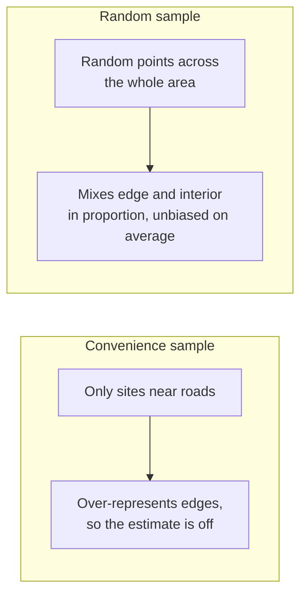

# Representative Sample

An election poll asks 1,000 people how they will vote. Ask 1,000 people outside one football stadium and the answer describes football fans in one city, not the country. Pick 1,000 phone numbers by a random draw across the whole country and every kind of voter has a fair chance of being asked, so the 1,000 will look roughly like the country. The sample size was the same both times; what changed was *how* people were chosen. A **representative sample** resembles its population in the features that matter for your question ([[Population and Sample]], [[Powell and Gale 2015 Ch2]]), and *random selection*, using a random-number process so that each unit has a known chance of being chosen, is the main way to make that likely. A *convenience sample* (units that are easy to reach) and a *haphazard* one (picked at whim) are not random and usually not representative.

A worked example. A wetland has 100 ponds: 20 next to roads hold about 30 frogs each, and the other 80 hold about 10 each. The true mean is (20 × 30 + 80 × 10) / 100 = 14 frogs. A convenience sample of 10 easy roadside ponds estimates 30, more than double the truth. A random sample of 10 ponds gets, on average, about 2 roadside and 8 others, so about (2 × 30 + 8 × 10) / 10 = 14. Sampling 50 roadside ponds instead of 10 would still say 30: more of the wrong thing is still wrong, and the error is [[Bias]].

Random selection works because it takes your choices out of the process: across all the random samples you might have drawn, nothing systematic separates sampled from unsampled units, so the estimate is right *on average*. Any single random sample can still be unlucky; larger samples make that less likely, and *stratified sampling*, sampling randomly within each habitat type, guarantees that key groups are included. What no analysis can do is fix a non-representative sample afterwards, because the information about the missing part was never collected; Powell and Gale stress that bias cannot be improved without re-evaluating the whole sampling scheme, and their parable of the blind men and the elephant, each touching one part and describing the whole wrongly, makes the same point. Big samples are not automatically representative, and representative does not mean perfect: the leftover luck of the draw is what the standard error measures ([[Sampling Variation]], [[Induction vs Deduction]]). Nearby units can also resemble each other ([[Spatial Autocorrelation]]), another way a sample can carry less independent information than it seems.


*What to look at:* the difference is in *how* the units were chosen, not how many.

```r
set.seed(4)
ponds <- data.frame(road = c(rep(TRUE, 20), rep(FALSE, 80)))
ponds$frogs <- ifelse(ponds$road, rpois(100, 30), rpois(100, 10))
mean(ponds$frogs)                                   # truth, about 14
mean(ponds$frogs[ponds$road][1:10])                 # convenience sample: about 30
mean(ponds$frogs[sample(100, 10)])                  # random sample: about 14 (varies)
```

## Connections
- **Builds on:** [[Population and Sample]], [[Induction vs Deduction]]
- **Leads to:** [[Bias and Precision]], [[Biological vs Statistical Population]], [[Independence of Observations]]
- **Part of:** [[MOC 02 - Modeling Foundations|MOC - Modeling Foundations]]
- **Go deeper:** [[Powell and Gale 2015 Ch2]]

## Flashcards

Why does random selection tend to give a representative sample?
??
It removes your choices from the process, so no feature of the units systematically decides which are sampled; the sample is unbiased on average.
++++

What does the blind men and the elephant story illustrate?
??
Real but non-representative samples lead to confident, wrong conclusions about the whole.
++++

Can a bigger sample fix a non-representative sampling method?
??
No: it gives a more precise estimate of the wrong thing. Only changing how units are chosen fixes it.
++++
