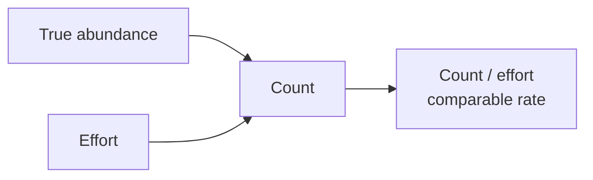

# Sampling Effort

Ten fish in one hour and ten fish in ten hours are very different fishing days, and you cannot compare catches until you know how long each line was in the water. **Sampling effort** is how much work went into collecting the data: hours searched, traps set, area covered or visits made. Every count has two parents, how many animals are really there and how hard you looked, and only one of them is biology ([[Count Data]]). Effort is not the same as [[Sample Size]]: sample size counts units, while effort measures the work spent per unit. An hour of fishing is an hour, but an hour of searching varies in quality with observer skill, weather and habitat.

Two wetlands are surveyed for frogs. Wetland A gives 12 frogs in 2 hours, 6 per hour. Wetland B gives 20 frogs in 10 hours, 2 per hour. Raw counts say B has more frogs; per unit effort, A has three times as many. The simplest fix is to divide each count by its effort, but that throws away the fact that 2 hours gives a much shakier number than 10. The better fix is to keep the raw count and put effort into the model as an [[Offset]]: in a Poisson model, `glm(frogs ~ site + offset(log(hours)), family = poisson)` makes the model about frogs per hour while keeping the counts as counts, with their proper uncertainty. Here it returns 6 frogs per hour at A and a rate at B one third as large ([[Poisson Regression]]).

Unequal effort is one of the most common hidden causes of spurious patterns in field data: sites near the field station get visited more, and good years attract more volunteers. Without accounting for it, the model ends up studying the observers instead of the animals. More effort also raises the chance of detecting a species at all, which links effort to [[Detection Probability]]. Zuur and colleagues cover offsets for unequal effort ([[Zuur et al. 2009 Ch9]]), and course datasets such as the DeSoto deer harvest include harvest per unit effort.


*What to look at:* the count has two parents, and only one of them is biology.

```r
d <- data.frame(site = c("A", "B"), frogs = c(12, 20), hours = c(2, 10))
d$frogs / d$hours                                  # 6 and 2 per hour
m <- glm(frogs ~ site + offset(log(hours)), family = poisson, data = d)
exp(coef(m))                                       # 6 per hour at A, and B is 0.33 times A
```
The offset makes the model about frogs per hour while keeping the counts as counts.

## Connections
- **Builds on:** [[Count Data]], [[Sample Size]]
- **Leads to:** [[Offset]], [[Detection Probability]], [[Poisson Regression]]
- **Part of:** [[MOC 02 - Modeling Foundations|MOC - Modeling Foundations]]

## Flashcards

What is sampling effort?
??
The amount of work behind a count: time, traps, area or visits.
++++

Why must effort be accounted for when comparing counts?
??
A larger count may reflect more searching, not more animals.
++++

How is effort included in a count model?
??
As an offset, the log of effort, in a Poisson or negative binomial model.
++++
