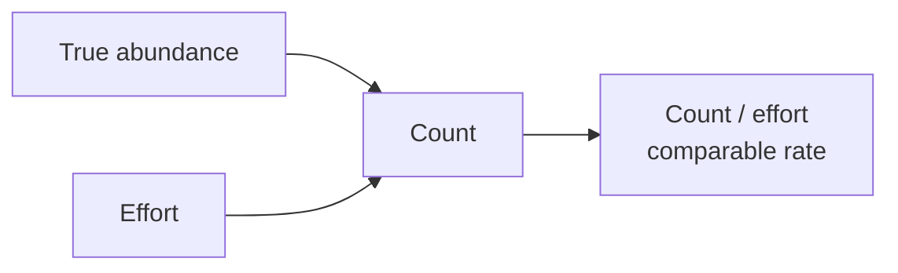

# Sampling Effort

**In one line:** sampling effort is how much work went into collecting the data, such as hours searched, traps set or area covered.

> [!info] Before this, it helps to know
> [[Count Data]] (how many were seen) · [[Sample Size]] (how many units)

## The everyday picture
Fishing. Ten fish in one hour and ten fish in ten hours are very different days. You can't compare catches until you know how long each line was in the water.

*Where the picture stops working:* an hour of fishing is an hour. Search effort varies in quality with observer skill, weather and habitat.

## A tiny example
Two wetlands surveyed for frogs.
- Wetland A: 12 frogs in 2 hours = **6 per hour**.
- Wetland B: 20 frogs in 10 hours = **2 per hour**.
- Raw counts say B has more. Per unit effort, A has three times as many.

## Start from zero
1. **A count depends on how many are there and how hard you looked.**
2. **Record the effort** for every count.
3. **Divide to compare.** Count per unit effort.
4. **Better, put effort in the model.** *Why:* dividing first throws away the fact that 2 hours gives a shakier number than 10. An [[Offset]] keeps the raw count and its proper uncertainty.
5. **More effort also raises the chance of detecting a species at all** ([[Detection Probability]]).

## See it

*What to look at:* the count has two parents, and only one of them is biology.

## Why it is this way
Unequal effort is the most common hidden cause of spurious patterns in field data. Sites near the station get visited more, and good years get more volunteers. Without accounting for effort, the model studies the observers.

## In R
```r
d <- data.frame(site = c("A", "B"), frogs = c(12, 20), hours = c(2, 10))
d$frogs / d$hours                                  # 6 and 2 per hour
m <- glm(frogs ~ site + offset(log(hours)), family = poisson, data = d)
exp(coef(m))                                       # 6 per hour at A, and B is 0.33 times A
```
The offset makes the model about frogs per hour while keeping the counts as counts.

## In the course
The DeSoto deer data include harvest per unit effort ([[Course Website]]). Zuur covers offsets for unequal effort ([[Zuur et al. 2009 Ch9]]).

## Common confusions
- **"Just analyse the ratio."** Ratios lose the information about how much effort stands behind them.
- **"Effort is the same as sample size."** Sample size counts units. Effort measures work per unit.

## Explain it back
- Why can raw counts from different sites mislead?
- What does an offset do that dividing doesn't?

*Pass test:* you can turn counts and effort into comparable rates and name the modeling tool for it.

## Connections
- **Builds on:** [[Count Data]], [[Sample Size]]
- **Leads to:** [[Offset]], [[Detection Probability]], [[Poisson Regression]]
- **Part of:** [[MOC 02 - Modeling Foundations|MOC - Modeling Foundations]]

## Flashcards

What is sampling effort?
??
The amount of work behind a count: time, traps, area or visits.
++++

Why must effort be accounted for when comparing counts?
??
A larger count may reflect more searching, not more animals.
++++

How is effort included in a count model?
??
As an offset, the log of effort, in a Poisson or negative binomial model.
++++
