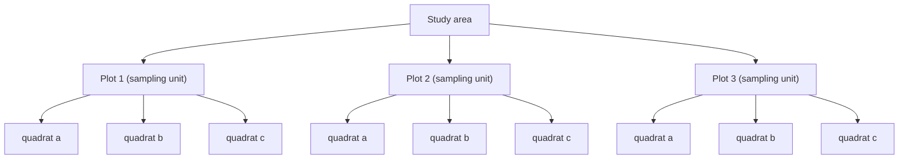

# Sampling Unit

You test whether a fertiliser makes tomatoes bigger using two greenhouses, one fertilised and one not, and weigh 100 tomatoes from each. That feels like 200 data points, but you have really compared one greenhouse with one other greenhouse. If the fertilised one was also sunnier or better watered, every one of its 100 tomatoes shares that luck. The **sampling unit** here is the greenhouse: the smallest piece of time and space that could be chosen, and given its condition, independently of the others. The tomatoes are *subsamples*, [[Repeated Measures|repeated measurements]] inside a unit. Powell and Gale define the [[Statistical Population|statistical population]] as the set of all such units ([[Powell and Gale 2015 Ch2]]), and your real [[Sample Size|sample size]] n is the number of units, not the number of measurements.

A field example. Three plots are burned and three left unburned, and five quadrats are measured in each plot, giving 6 × 5 = 30 measurements. Fire was applied to whole plots, so for the burn effect the sampling units are the 6 plots. A model that treats the 30 quadrats as independent claims 30 − 2 = 28 *[[Degrees of Freedom|degrees of freedom]]* (roughly, the independent pieces of information left after estimating the model's parameters) for judging the effect; the honest number, from 6 plots, is 6 − 2 = 4. It claims seven times as many independent pieces of evidence as there are, so the [[Standard Error]] comes out too small and the effect looks more certain than it is. That mistake is [[Pseudoreplication]].

The reason is that measurements within a unit share its conditions, the same soil, weather, fire and history, so they are more alike than measurements from different units and do not each bring fresh evidence ([[Independence of Observations]]). Extra quadrats are not useless: they pin down each plot's value more precisely. But they do not increase n. There are two fixes: average the measurements within each unit and analyse one value per unit, or use a [[Mixed Effects Model|mixed model]] with a [[Random Effect|random effect]] for the unit, which tells the model which measurements belong together ([[Random Intercept]], [[Harrison et al. 2018]]). The unit is whatever the treatment or condition was applied to independently, not whatever you happened to measure, and an observation (a row in your data) is not the same as a unit, since several rows can share one ([[Variable and Observation]]).


*What to look at:* 9 measurements but only 3 sampling units. To compare plots, n = 3.

```r
set.seed(5)
# 6 plots, 5 quadrats each
d <- data.frame(plot = rep(1:6, each = 5),
                burned = rep(c(1, 0), each = 15),
                cover = c(rnorm(15, 40, 5), rnorm(15, 50, 5)))
length(unique(d$plot))         # 6 sampling units, not 30
# Option 1: average to one value per unit, then analyse the 6 values
plot_means <- aggregate(cover ~ plot + burned, data = d, FUN = mean)
summary(lm(cover ~ burned, data = plot_means))
# Option 2 (later in the course): keep the quadrats and add a random effect for plot
# lme4::lmer(cover ~ burned + (1 | plot), data = d)
```

## Connections
- **Builds on:** [[Variable and Observation]], [[Population and Sample]], [[Statistical Population]], [[Sample Size]], [[Degrees of Freedom]]
- **Leads to:** [[Pseudoreplication]], [[Biological vs Statistical Population]], [[Grouping Variable|Grouping Factor]], [[Independence of Observations]], [[Repeated Measures]], [[Mixed Effects Model]], [[Random Effect]]
- **See also:** [[MOC 14 - Mixed Models]]
- **Part of:** [[MOC 02 - Modeling Foundations|MOC - Modeling Foundations]]
- **Go deeper:** [[Harrison et al. 2018]]

## Flashcards

What is a sampling unit?
??
The smallest independent piece of time and space you sample (plot, pond, transect-season); the count of these is your true sample size.
++++

6 plots with 5 quadrats each: what is n for comparing plots, and why?
??
6, because quadrats within a plot share its conditions and are not independent.
++++
