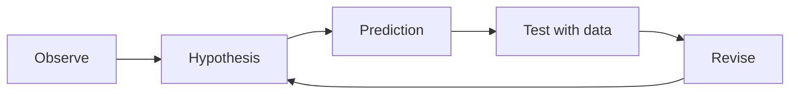

# Scientific Method

**In one line:** the scientific method is a loop: observe, propose an explanation, work out what it predicts, test the prediction against new data, and revise.

> [!info] Before this, it helps to know
> [[Hypothesis]] (a testable explanation) · [[Induction]] (pattern to rule) · [[Deduction]] (rule to prediction)

## The everyday picture
Fixing a lamp that won't light. You guess "the bulb is dead". That predicts a new bulb will work. You try it. If the lamp stays dark, the guess was wrong and you move to "the fuse". Guess, predict, test, revise.

*Where the picture stops working:* a lamp gives a clear yes or no. Ecological tests give noisy, partial answers.

## Words you'll need
- **Observation:** something noticed in nature.
- **Prediction:** what must be seen if the hypothesis is true.
- **Falsify:** to show a prediction fails.

## A tiny example
- Observe: fewer grassland birds near trees.
- Hypothesis: birds avoid trees because predators perch there.
- Prediction: removing trees raises nest survival within two seasons.
- Test: clear trees on 10 plots, keep 10 as they are. Survival 0.45 against 0.30.
- Revise: support for the hypothesis. Next, test whether predators really declined.

## Start from zero
1. **Start from a puzzle in observations.**
2. **Propose an explanation.** This step is induction.
3. **Deduce a prediction that could fail.** *Why:* a claim that fits any outcome can't be tested.
4. **Collect data designed to test it.**
5. **Compare and revise.** Then go round again.
6. **Models are the middle of the loop.** They turn a hypothesis into numbers data can contradict.

## See it

*What to look at:* it is a loop, not a line.

## Why it is this way
People are good at seeing patterns that aren't there and at favouring ideas they like. The method builds in a step where nature can say no. Statistical modeling is how that step is carried out when the data are noisy.

## In R
```r
# the test step, with made-up nest counts
cleared   <- c(alive = 45, dead = 55)
uncleared <- c(alive = 30, dead = 70)
prop.test(c(45, 30), c(100, 100))   # is 0.45 vs 0.30 more than chance?
```
The small p-value says a difference this large would be unusual if clearing did nothing ([[P-value]]).

## In the course
Powell and Gale place models inside the scientific method and management ([[Powell and Gale 2015 Ch1]]). The model selection lab starts by writing hypotheses in words ([[Course Website]]).

## Common confusions
- **"Science proves hypotheses."** It fails to reject them, for now.
- **"Data collection comes first."** The question and prediction should shape what is collected.

## Explain it back
- Which step is induction and which is deduction?
- Why must a prediction be able to fail?

*Pass test:* you can walk an example around the loop.

## Connections
- **Builds on:** [[Hypothesis]], [[Induction]], [[Deduction]]
- **Leads to:** [[Hypothetico-deductive Method]], [[Strong Inference]], [[Modeling Process]]
- **Part of:** [[MOC 02 - Modeling Foundations|MOC - Modeling Foundations]], molecular note [[Induction vs Deduction]]

## Flashcards

What are the steps of the scientific method?
??
Observe, hypothesize, predict, test against data, revise, and repeat.
++++

Why must a prediction be falsifiable?
??
If no outcome could contradict it, testing it tells you nothing.
++++

Where do models sit in the scientific method?
??
They turn hypotheses into quantitative predictions that data can test.
++++
