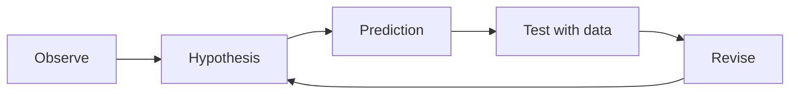

# Scientific Method

A lamp will not light. You guess "the bulb is dead", which predicts that a new bulb will work. You try it; if the lamp stays dark, the guess was wrong and you move to "the fuse". Guess, predict, test, revise. The **scientific method** is that loop: observe something puzzling, propose an explanation (a [[Hypothesis]]), work out what it predicts, test the prediction against new data, and revise. Going from observations to a general explanation is [[Induction]]; going from the explanation to a specific prediction is [[Deduction]]. A lamp gives a clear yes or no, while ecological tests give noisy, partial answers, which is where statistics comes in.

Walk an example around the loop. Observation: there are fewer grassland birds near trees. Hypothesis: birds avoid trees because predators perch in them. Prediction: removing trees will raise nest survival within two seasons. Test: clear trees on 10 plots and leave 10 as they are; nest survival comes out 0.45 against 0.30. A statistical test asks whether a difference that large would be unusual if clearing did nothing ([[P-value]]). Revise: the hypothesis gains support, and the next turn of the loop tests whether predators really declined. The prediction had to be able to fail, because a claim that fits any outcome cannot be tested.

Why bother with all this? Because people are good at seeing patterns that are not there and at favouring ideas they like, and the method builds in a step where nature can say no. Science never proves a hypothesis; it fails to reject it, for now. And the order matters: the question and the prediction should shape what data are collected, not the other way round. Models sit in the middle of the loop, turning a hypothesis into numbers that data can contradict, which is why the course's model selection lab starts by writing hypotheses in words ([[Modeling Process]], [[Powell and Gale 2015 Ch1]]). The formal version of the test step is the [[Hypothetico-deductive Method]], and testing several rivals at once is [[Strong Inference]].


*What to look at:* it is a loop, not a line.

```r
# the test step, with made-up nest counts
cleared   <- c(alive = 45, dead = 55)
uncleared <- c(alive = 30, dead = 70)
prop.test(c(45, 30), c(100, 100))   # is 0.45 vs 0.30 more than chance?
```
The small p-value says a difference this large would be unusual if clearing did nothing ([[P-value]]).

## Connections
- **Builds on:** [[Hypothesis]], [[Induction]], [[Deduction]]
- **Leads to:** [[Hypothetico-deductive Method]], [[Strong Inference]], [[Modeling Process]]
- **Part of:** [[MOC 02 - Modeling Foundations|MOC - Modeling Foundations]], molecular note [[Induction vs Deduction]]

## Flashcards

What are the steps of the scientific method?
??
Observe, hypothesize, predict, test against data, revise, and repeat.
++++

Why must a prediction be falsifiable?
??
If no outcome could contradict it, testing it tells you nothing.
++++

Where do models sit in the scientific method?
??
They turn hypotheses into quantitative predictions that data can test.
++++
